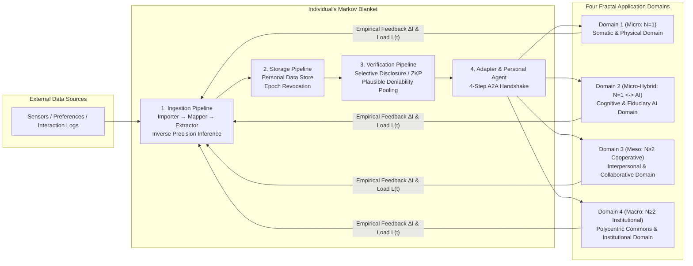

Version: 4.2.0
Effective Baseline Date: Prior to 2026-09-01 (Baseline Specification v4.0.0 Prior IP)
Author: Praxeophysics Institute
Specification License: CC BY 4.0 International
Reference Code License: Apache License 2.0

* **Canonical Glossary**: [[02_Glossary|Praxeophysics Canonical Glossary]]
* **Six Fundamental Trade-offs and Twelve Pathologies**: [[03_Breakthroughs|Six Fundamental Trade-offs and Twelve Pathologies]]

* **Canonical Index**: [[00_Canonical_Index|Canonical Knowledge Index]]

---

## 1. Architectural Overview and Core Principles
The Praxeophysics Protocol defines a domain-neutral, self-sovereign computational architecture that shifts the locus of adaptation from rigid external standards to the individual's internal priors. Grounded in the Free Energy Principle ([[Term_Active_Inference|Active Inference]] & Cybernetics), Praxeology ([[Term_Demonstrated_Preference|Demonstrated Preference]], [[Term_Subjective_Value|Subjective Value]], and [[Term_Synallactics|Synallactics]]), and Critical Epistemology ([[Term_Apoha|Apoha]] Threshold Demarcation & [[Term_Two_Truths|Two-Tier Separation]]), the protocol minimizes variational friction across physical environments, interpersonal and multi-agent couplings, and polycentric institutions.



### 1-1. Unified Architecture: Four Blanket States, Roles and Four Temporal Dynamics
The protocol operationalizes the four states and cognitive roles of a Markov blanket across the four temporal scales of free energy minimization ([[Term_Perceptual_Inference|Perceptual Inference]], [[Term_Active_Inference|Active Inference]], Learning, [[Term_Niche_Construction|Niche Construction]]):

| Role / State | Boundary Position & Vector | Direct Target | Information-Processing Role & Biological/System Analog | Corresponding Protocol Pipeline & Modules |
| :--- | :--- | :--- | :--- | :--- |
| **Observation / [[Term_Sensory_States\|Sensory States]]** | Boundary Input<br>Out $\to$ In | [[Term_Internal_States\|Internal States]] | Reception of external signals & encoding of observations<br>Analog: Eyes, ears, skin, sensors, API inputs | **1. [[Term_Ingestion\|Ingestion Pipeline]]** (`Importer` / `Mapper` / `Extractor`)<br>Ontology mapping, $(\boldsymbol{\mu}, \boldsymbol{\Pi}, L(t))$ extraction, [[Term_Inverse_Precision_Inference\|Inverse Precision Inference]] of $r_d(t)$ |
| **Inference / [[Term_Internal_States\|Internal States]]** | Interior of Blanket<br>In $\to$ In | [[Term_Active_States\|Active States]] | Retention & updating of generative models, prediction computation<br>Analog: Neural circuits, beliefs, personal database | **2. [[Term_Storage_Holder\|Storage Pipeline]]** (`Holder` / [[Term_Storage_Holder\|Personal Data Store]])<br>Exclusive retention of $(\boldsymbol{\mu}, \boldsymbol{\Pi}, L(t))$ & $\ker \Phi$, $\mathbf{x} \perp R_c$ separation, [[Term_Epoch_Reconfiguration\|Epoch Revocation]] |
| **Action / [[Term_Active_States\|Active States]]** | Boundary Output<br>In $\to$ Out | [[Term_External_States\|External States]] | Physical & informational intervention guided by inference<br>Analog: Muscles, vocal cords, limbs, actuators | **3. [[Term_Verification\|Verification Pipeline]]** (`Prover` / `Verifier` / [[Term_Personal_Agent_A2A\|Personal Fiduciary Agent]])<br>[[Term_Selective_Disclosure\|Selective Disclosure]] / [[Term_ZKP\|ZKP]], [[Term_Plausible_Deniability\|Plausible Deniability]], 4-step A2A handshake |
| **Dynamics / [[Term_External_States\|External States]]** | Exterior of Blanket<br>Out $\to$ Out | [[Term_Sensory_States\|Sensory States]] | Autonomously evolving environmental & multi-agent dynamics<br>Analog: Physical laws, other agents, markets, natural environment | **4. [[Term_Reconciliation_Adapter\|Reconciliation Adapter]]** (`Adapter`)<br>Rule circuit $R_c$ evaluation, [[Term_Alignment\|Environmental Alignment]], 4 Directives, [[Term_Strategy_Proofness\|Strategy-Proof ZKP]] |
| **Dynamics: [[Term_Perceptual_Inference\|Perceptual Inference]]** | Immediate (ms–s) | Internal Beliefs | Receptive updating in wide-radius (low-$\Pi_d$) dimensions | `perceptual_update` and delegating party in **`COMPLEMENTARY_DELEGATION`** |
| **Dynamics: [[Term_Active_Inference\|Active Inference]]** | Short-term (s–min) | External Boundary | Boundary enforcement in narrow-radius (high-$\Pi_d$) dimensions | [[Term_Alignment\|Environmental Alignment]], **`ALLOSTATIC_LOAD_RELIEF`**, **`FRICTIONLESS_EXIT_SORTING`** |
| **Dynamics: [[Term_Dynamic_Boundary_Learning\|Learning]]** | Medium-term (days–yrs) | Model Priors | Bayesian updating of $(\boldsymbol{\mu}, \boldsymbol{\Pi}, r_d)$ from empirical load $L(t)$ | [[Term_Dynamic_Boundary_Learning\|Dynamic Boundary Learning]] & [[Term_Epoch_Reconfiguration\|Epoch Re-configuration]] |
| **Dynamics: [[Term_Niche_Construction\|Niche Construction]]** | Long-term (yrs–eras) | Shared Niche | Structural design of low-friction interfaces & rules | **`INTERFACE_DECOUPLING`**, [[Term_Strategy_Proofness\|Strategy-Proof ZKP Settlement]], [[Term_Synallactics\|Synallactics]] |

### 1-2. Taxonomy of Adaptive Processes

| Operation | Coupling Topology | Formal Condition | Canonical Definition |
| :--- | :--- | :--- | :--- |
| **[[Term_Adaptation\|Adaptation]]** | Overarching Closed Loop | Continuous across epochs $t_k$ | The overarching process wherein a bounded system preserves its Markov blanket while minimizing variational free energy via internal generative updating and active boundary intervention |
| **[[Term_Alignment\|Environmental Alignment]]** | Micro ($N = 1$)<br>Individual $\leftrightarrow$ Environment | Valid Predicate $x_d = 1$ | Optimizing external physical, spatial, or informational parameters to match a single agent's internal prior ($\mu_d$) within its allowable tolerance radius ($r_d(t)$) |
| **[[Term_Reconciliation\|Complementary Reconciliation]]** | Meso ($N \ge 2$, Cooperative)<br>Agent A $\leftrightarrow$ Agent B / Group | SAT ($\mathcal{U}_A \cap \mathcal{U}_B \neq \emptyset$) | Deriving mutually consistent interaction parameters via **[[Term_Complementary_Delegation\|Complementary Delegation]]** (`COMPLEMENTARY_DELEGATION`) or **[[Term_Interface_Decoupling\|Interface Decoupling]]** (`INTERFACE_DECOUPLING`) that satisfy protective boundaries and minimize joint variational friction |
| **[[Term_Strategy_Proofness\|Strategy-Proof Settlement]]** | Macro ($N \ge 2$, Competitive)<br>Multi-Party $\leftrightarrow$ Institutional Rules | SAT via Reference $p_{\text{ref}}$ | Executing incentive-compatible agreements over scarce resources or contracts using [[Term_ZKP\|Zero-Knowledge Proofs]] (ZKP) against an independent reference threshold ($p_{\text{ref}}$), preventing reservation value exploitation |
| **[[Term_Frictionless_Exit\|Frictionless Exit and Sorting]]** | Meso / Macro Safety Valve<br>Multi-Agent Deadlock | UNSAT ($\mathcal{U}_A \cap \mathcal{U}_B = \emptyset$) | Decoupling an interaction without penalty (`FRICTIONLESS_EXIT_SORTING`) and sorting agents into compatible alternative niches when mutually required protective boundaries cannot be simultaneously satisfied |

### 1-3. Five Core Design Axioms
1. **Individual-Origin Control**: The reference baseline for evaluation resides exclusively within the individual's Markov blanket ([[Claim_Internal_Prior_Sovereignty|Exclusive Sovereignty of Internal Priors and Law of Requisite Variety]], [[Claim_Subjective_Ordinal_Value|Subjective Value as Internal Preference Ordering]])
2. **Orthogonal [[Term_Atomic_Predicate|Atomic Predicates]] over Scalar Reduction**: Multi-dimensional states are never collapsed into a single scalar score; they are maintained as orthogonal vectors evaluated as binary guardrail predicates $x_d(t) \in \{0, 1\}$ ([[Claim_Binary_Guardrail_Predicate|Binary Guardrail Predicate Function Based on Causal Efficacy]], [[Claim_Rejection_Of_Scalar_Reduction|Rejection of Single-Scalar Reduction and Preservation of Orthogonality]], [[Claim_Typed_Vector_Lazy_Evaluation|Typed Atomic Attribute Vectors and Lazy Binary Predicate Evaluation]])
3. **Structural Separation of Attributes and Contextual Rules**: Personal state representations stored in the [[Term_Storage_Holder|Personal Data Store]] are strictly decoupled from contextual evaluation policies, enabling cross-domain portability without re-acquisition ($\mathbf{x} \perp R_c$: [[Claim_Attribute_Rule_Separation|Structural Separation of Personal Attributes and Contextual Rules]])
4. **Minimization of Variational Friction**: The global objective function of the protocol is the minimization of precision-weighted prediction errors across all coupled interfaces ([[Claim_Variational_Free_Energy_Minimization|Generative Updating and Action via Variational Free Energy Minimization]], [[Claim_Action_As_Friction_Minimization|Purposeful Action as Variational Friction Minimization]])
5. **Infrastructure and Domain Neutrality**: The protocol operates as an open upper-layer specification independent of any specific database, cryptographic primitive, user interface, or application domain ([[Claim_Bounded_Rationality_Open_Schema|Bounded Rationality and the Necessity of Open Schema Extension]], [[Claim_Catallactics_Synallactics_Complementarity|Complementarity of Catallactics and Synallactics]])

---

## 2. System Topology: Four Pipelines and Personal Fiduciary Agent

| Pipeline Stage | Module Components | Core Responsibility & Output |
| :--- | :--- | :--- |
| **1. [[Term_Ingestion\|Ingestion Pipeline]]** | `1-1. Importer`<br>`1-2. Mapper`<br>`1-3. Extractor` | Ingests raw sensor streams, preference settings, or interaction logs; maps them to shared ontology URIs (`ontologyRef`); extracts the [[Term_Internal_Generative_State\|Internal Generative State]] ($\boldsymbol{\mu}, \boldsymbol{\Pi}, L(t)$) and derives protective boundaries via [[Term_Inverse_Precision_Inference\|Inverse Precision Inference]] |
| **2. [[Term_Storage_Holder\|Storage Pipeline]]** | `2-1. Holder` | Stores user-verified, cryptographically signed claims in a [[Term_Storage_Holder\|Personal Data Store]] under self-sovereign control; enforces strict separation from contextual rules; manages [[Term_Epoch_Reconfiguration\|Epoch Re-configuration and Revocation]] when states change |
| **3. [[Term_Verification\|Verification Pipeline]]** | `3-1. Prover`<br>`3-2. Verifier` | Evaluates binary [[Term_Apoha\|Apoha]] predicates $x_d(t) \in \{0, 1\}$ against [[Term_Contextual_Rule_Circuit\|contextual rule circuits]] $R_c$; executes [[Term_Selective_Disclosure\|Selective Disclosure]] in cooperative contexts or [[Term_ZKP\|Zero-Knowledge Proofs]] in asymmetric contexts; enforces [[Term_Plausible_Deniability\|Plausible Deniability]] by pooling protective constraints with everyday preferences |
| **4. [[Term_Reconciliation_Adapter\|Reconciliation and Alignment Pipeline]]** | `4-1. Adapter` ([[Term_Reconciliation_Adapter\|Reconciliation Adapter]])<br>Cross-Cutting: [[Term_Personal_Agent_A2A\|Personal Fiduciary Agent]] | Executes the 4-step A2A handshake (`1. Schema Exchange` $\to$ `2. Request Policy` $\to$ `3. Submit Proof` $\to$ `4. Issue Settlement`); outputs domain-neutral Alignment Parameters, the four Reconciliation Directives, or ZKP Settlements across Domains 1–4 |

---

## 3. Mathematical Specification: Dynamic Boundary Generative Model
In the [[Term_Ingestion|Ingestion Pipeline]], raw physical or contextual inputs are mapped via `ontologyRef` reference scales onto an orthogonalized, **[[Term_Dimensionless_Normalization|Dimensionless Normalized Feature Space]]** (e.g., $[0, 1]^D$). Under the [[Term_Laplace_Approximation|Laplace approximation]] (Gaussian generative density $\mathcal{N}(\boldsymbol{\mu}, \boldsymbol{\Pi}^{-1})$), an agent's internal continuous state across $D$ orthogonal dimensions is parameterized by three dimensionless quantities—the [[Term_Internal_Generative_State|Internal Generative State]] ($\boldsymbol{\mu}, \boldsymbol{\Pi}, L(t)$):

1. **[[Term_Prior_Distribution|Prior Mean Vector]] ($\boldsymbol{\mu} \in \mathbb{R}^D$)**: The baseline expectation value in each dimension $d \in \{1, \dots, D\}$ where prediction error is zero ([[Claim_Internal_Prior_Sovereignty|Exclusive Sovereignty of Internal Priors and Law of Requisite Variety]], [[Claim_Subjective_Ordinal_Value|Subjective Value as Internal Preference Ordering]])
2. **[[Term_Precision_Weighting|Precision Weighting Vector]] ($\boldsymbol{\Pi} \in \mathbb{R}_+^D$)**: The inverse variance ($\Pi_d = \sigma_d^{-2}$) representing sensitivity or attentional commitment to dimension $d$, governed by the finite resource conservation law ([[Claim_Prior_Hyper_Precision_Reification|Conceptual Reification via Prior Hyper-Precision and Overfitting]], [[Claim_Attentional_Precision_Conservation|Conservation of Finite Attentional Precision and Delegation Margins]]):
   $$\sum_{d=1}^D \Pi_d = \Pi_{\text{budget}} < \infty$$
3. **[[Term_Allostatic_Load|Normalized Allostatic Load]] ($L(t) \in [0, 1)$)**: Cumulative unresolved variational free energy integrated over recent epochs, reducing the agent's remaining **[[Term_Homeostatic_Capacity|Homeostatic Capacity]]** $C(t) = 1 - L(t)$ ([[Claim_Nonequilibrium_Steady_State|Nonequilibrium Steady State and Self-Organization]], [[Claim_Uniform_Standard_Allostatic_Load|Over-Adaptation to Uniform Standards and Accumulation of Allostatic Load]])

### 3-1. Principle of Interior Opacity, Precision-Tolerance Reciprocity & Boundary Envelopes ([[Claim_Interior_Opacity_Principle|Principle of Interior Opacity and Apoha Boundary Sufficiency]])
Given an external stimulus or coupling state $s_d$ in dimension $d$, the instantaneous variational free energy is:
$$F_d(s_d) = \frac{1}{2} \Pi_d (s_d - \mu_d)^2$$

Applying the Threshold Demarcation ([[Term_Apoha|Apoha]]) Function ([[Claim_Binary_Guardrail_Predicate|Binary Guardrail Predicate Function Based on Causal Efficacy]]) against the remaining homeostatic capacity $1 - L(t)$ directly yields the binary [[Term_Atomic_Predicate|Atomic Predicate]] $x_d(t) \in \{0, 1\}$ and the [[Term_Allowable_Tolerance_Radius|Allowable Tolerance Radius]] $r_d(t)$:

* **Binary Guardrail Predicate**:
  $$x_d(t) = \mathbb{I}\left(\frac{1}{2} \Pi_d (s_d - \mu_d)^2 \le 1 - L(t)\right) \in \{0, 1\}$$
* **[[Term_Allowable_Tolerance_Radius|Allowable Tolerance Radius]]**:
  $$r_d(t) = \sqrt{\frac{2(1 - L(t))}{\Pi_d}} \quad \left(\text{such that } x_d(t) = 1 \iff \lvert s_d - \mu_d \rvert \le r_d(t)\right)$$

### 3-2. Worked Numerical Benchmark: 1D Scalar Models vs. Dynamic Boundary Model
In conventional matching and recommendation algorithms, any pair with baseline divergence $\Delta\mu = \lvert \mu_A - \mu_B \rvert = 0.40$ receives the identical scalar score (`0.60`) and midpoint parameter (`0.50`). The [[Term_Dynamic_Boundary_Model|Dynamic Boundary Generative Model]] resolves this ambiguity into four distinct operational regimes:

| Coupling Context | Agent Parameters ($\mu, \Pi, L(t)$) | Derived Radii ($r_A, r_B$) & Intersection | Conventional 1D Algorithm Output | Praxeophysics Directive & Prescription |
| :--- | :--- | :--- | :--- | :--- |
| **Case 1: Co-Living & Care**<br>Asymmetric Sensory Commitment | $\mu_A=0.30, \Pi_A=9.0, L_A=0.15$<br>$\mu_B=0.70, \Pi_B=1.0, L_B=0.15$ | $r_A=0.43, r_B=1.30$<br>$\Delta\mu (0.40) \le 1.73$ (**SAT**) | Scalar Score `0.60`<br>(Uniform midpoint `0.50`) | **`COMPLEMENTARY_DELEGATION`**<br>$A$ has a narrow radius while $B$ is wide; aligning with $A$'s standard ($u^*_d \approx \mu_A$) while $B$ delegates minimizes joint friction |
| **Case 2: Open Science / OSS**<br>Symmetric Methodological Autonomy | $\mu_A=0.30, \Pi_A=2.0, L_A=0.10$<br>$\mu_B=0.70, \Pi_B=2.0, L_B=0.10$ | $r_A=0.95, r_B=0.95$<br>$\Delta\mu (0.40) \le 1.90$ (**SAT**) | Scalar Score `0.60`<br>(Uniform midpoint `0.50`) | **`INTERFACE_DECOUPLING`**<br>Both maintain distinct workflows within viable bounds; decouple internal processes and coordinate strictly via a shared interface schema |
| **Case 3: Shared Commons / Partnership**<br>Rigid Guardrail Clash | $\mu_A=0.30, \Pi_A=50.0, L_A=0.20$<br>$\mu_B=0.70, \Pi_B=50.0, L_B=0.20$ | $r_A=0.18, r_B=0.18$<br>$\Delta\mu (0.40) > 0.36$ (**UNSAT**) | Scalar Score `0.60`<br>(Uniform midpoint `0.50`) | **`FRICTIONLESS_EXIT_SORTING`**<br>Radii do not intersect; a midpoint ($0.50$) violates both guardrails, requiring non-penalized separation into parallel niches |
| **Case 4: Caregiving / AI Pacing**<br>Acute Cognitive/Somatic Overload | $\mu_A=0.30, \Pi_A=2.0, L_A=0.85$<br>$\mu_B=0.70, \Pi_B=2.0, L_B=0.10$ | $r_A=0.39$ ($L_A \ge 0.75$)<br>Capacity contracted | Scalar Score `0.60`<br>(Static parameter weight) | **`ALLOSTATIC_LOAD_RELIEF`**<br>Triggered by acute depletion of capacity $1-L_A(t)$; suspend alignment demands and prioritize capacity recovery |

---

### 3-3. Four Fractal Application Domains and Protocol Walkthroughs
Structured by the **2×2 Coupling Topology Matrix** (**Single-Principal $N=1$ vs. Multi-Principal $N \ge 2$** $\times$ **Cooperative Homeostasis vs. Asymmetric/Institutional Boundary Defense**) across the scale-invariant [[Term_Nested_Markov_Blanket|nested topology of Markov blankets]] ([[Claim_Nested_Blanket_Scale_Invariance|Recursive Composition of Nested Markov Blankets and Scale Invariance across Four Domains]]) (**Somatic/Physical $\subset$ Cognitive/Fiduciary AI $\subset$ Interpersonal/Collaborative $\subset$ Polycentric Commons/Institutional**), the [[Term_Dynamic_Boundary_Model|Dynamic Boundary Generative Model]] ($r_d(t) = \sqrt{2(1 - L(t))/\Pi_d}$) operates identically across **four fractal application domains (Domains 1–4)**:

| Application Domain & Coupling Topology | Structural Problem in Conventional Systems | Adaptive Processes & Directives |
| :--- | :--- | :--- |
| **Domain 1: Somatic and Physical Domain**<br>Micro ($N = 1 \leftrightarrow \text{Physical Environment}$) | Across apparel/fashion materials, cosmetics/skincare ingredients, dining/nutrition, and spatial acoustics/lighting, individuals face a binary trap: suffer boundary violations from standardized products/spaces or disclose private sensitivities across fragmented brand silos | • [[Term_Alignment\|Environmental Alignment]]<br>• [[Term_Plausible_Deniability\|Plausible Deniability]]<br>• `ALLOSTATIC_LOAD_RELIEF`<br>• `FRICTIONLESS_EXIT_SORTING` |
| **Domain 2: Cognitive and Fiduciary AI Domain**<br>Micro-Hybrid ($N = 1 \leftrightarrow \text{Fiduciary AI}$) | Ad-driven platforms extract attention and lock user preferences inside proprietary silos; shifting to an [[Term_Intention_Economy\|Intention Economy]] requires a local fiduciary AI agent that filters cross-brand goods/information against the user's self-sovereign `Holder` ($\mathbf{x} \perp R_c$) while blocking cognitive overload and preserving $\ker \Phi$ | • `ALLOSTATIC_LOAD_RELIEF`<br>• `COMPLEMENTARY_DELEGATION`<br>• `INTERFACE_DECOUPLING` (protecting $\ker \Phi$)<br>• [[Term_Dynamic_Boundary_Learning\|Dynamic Boundary Learning]] |
| **Domain 3: Interpersonal and Collaborative Domain**<br>Meso-Cooperative ($N \ge 2 \text{ Coupled Agents}$) | Across **(a) Dating, Marriage & Co-Living**, **(b) Group Dining, Travel & Leisure Coordination**, and **(c) Care, Education & Decentralized Co-Creation**, conventional 1D similarity scores and 50:50 compromises fail to detect hidden UNSAT dealbreakers, social stigma in group budget/diet choices, and asymmetric precision commitments | • `COMPLEMENTARY_DELEGATION`<br>• `INTERFACE_DECOUPLING`<br>• `ALLOSTATIC_LOAD_RELIEF`<br>• `FRICTIONLESS_EXIT_SORTING` |
| **Domain 4: Polycentric Commons and Institutional Domain**<br>Macro-Institutional ($N \ge 2 \text{ Scarce Commons}$) | Shared civic commons zoning, P2P contracting, and Alternative Dispute Resolution (ADR) suffer from Myerson-Satterthwaite bluffing deadlocks and rent extraction by monopolistic platforms | • [[Term_Strategy_Proofness\|Strategy-Proof ZKP Settlement]] ($v_A^{\min} \le p_{\text{ref}} \le v_B^{\max}$)<br>• `FRICTIONLESS_EXIT_SORTING`<br>• `INTERFACE_DECOUPLING`<br>• [[Term_Attribute_Rule_Separation\|Attribute-Rule Separation]] |

> [!example] Walkthrough 1 [Domain 1: Somatic and Physical Domain] — Privacy-Preserving Sensory Alignment
> ```mermaid
> flowchart LR
>     P1["1. Ingestion Pipeline<br>Derive narrow r_d(t) from high Pi_d<br>via Inverse Precision"] --> P2["2. Personal Data Store<br>Retain (mu, Pi, L) locally<br>Decoupled from facility rules"]
>     P2 --> P3["3. Verification Pipeline<br>Submit pooled predicate<br>z_d = x_sens OR x_pref"]
>     P3 --> P4["4. Space / Retail Adapter<br>Tune physical parameters<br>or ALLOSTATIC_LOAD_RELIEF"]
>     P4 -->|"5. Empirical Load Feedback"| P1
> ```
> 1. **Ingestion**: Without requiring explicit negative self-reporting or awkward verbal explanations, the [[Term_Storage_Holder|Personal Data Store]] derives narrow tolerance radii $r_d(t)$ across tactile/fabric materials, cosmetic ingredients, acoustic/lighting comfort, service interaction pacing (e.g., quiet salon/mobility rides), or dietary/budget bounds directly from positive precision commitments $\Pi_d$
> 2. **Storage**: Retained locally in the [[Term_Storage_Holder|Personal Data Store]] and reused portably across apparel/cosmetics filtering, dining, transit, hospitality, and architecture ($\mathbf{x} \perp R_c$)
> 3. **Verification**: High-priority personal constraints ($x_{\text{sens}}$: whether budget limits, social-energy boundaries, sensory sensitivities, or allergies) are pooled with ordinary everyday moods ($x_{\text{pref}}$) via $z_d = x_{\text{sens}} \lor x_{\text{pref}}$, allowing frictionless boundary enforcement without social awkwardness or reverse-inference of private reasons
> 4. **Output**: Executes [[Term_Alignment|Environmental Alignment]] within $r_d(t)$, triggers `ALLOSTATIC_LOAD_RELIEF` when cumulative load $L(t) \ge 0.75$, and routes occupants via `FRICTIONLESS_EXIT_SORTING` when spatial needs are mutually UNSAT

> [!example] Walkthrough 2 [Domain 2: Cognitive and Fiduciary AI Domain] — Attention Protection & Epistemic Exploration
> ```mermaid
> flowchart LR
>     State["Internal State (μ, Π, L(t))"] --> Calc["Compute Radius r_d(t) = √(2(1-L)/Π_d)"]
>     Calc --> Check{"Load L(t) ≥ 0.75 or High Focus Π_d?"}
>     Check -->|"Yes"| Throttle["ALLOSTATIC_LOAD_RELIEF & INTERFACE_DECOUPLING<br>Block AI interruptions & preserve tacit margin"]
>     Check -->|"No"| Explore["COMPLEMENTARY_DELEGATION & Epistemic Mode<br>Delegate low-Π routines & unlock exploration"]
> ```
> 1. **Fiduciary Binding**: Held strictly inside the local [[Term_Personal_Agent_A2A|Personal Fiduciary Agent]] bound as an [[Term_Extended_Markov_Blanket|Extended Markov Blanket]] ([[Claim_Extended_Blanket_Fiduciary_Agency|Property Boundaries and Fiduciary AI as Extended Markov Blankets]], [[Claim_Personal_Fiduciary_Agent_A2A|Cross-Cutting Substrate: Personal Fiduciary Agent and 4-Step A2A Handshake]])
> 2. **Protocol Operations**:
>    * **`ALLOSTATIC_LOAD_RELIEF`**: When cognitive load $L(t) \ge 0.75$, the allowable interruption radius $r_d(t)$ contracts, muting non-urgent AI prompts
>    * **`COMPLEMENTARY_DELEGATION`**: On low-$\Pi_d$ administrative dimensions where the user has wide tolerance, tasks are delegated to the fiduciary agent
>    * **`INTERFACE_DECOUPLING`**: On high-$\Pi_d$ creative dimensions, the AI refrains from intervening inside the viable tacit zone ($\ker \Phi$), unlocking [[Term_Epistemic_Value|Epistemic Value]] exploration once $L(t)$ recovers

> [!example] Walkthrough 3 [Domain 3: Interpersonal and Collaborative Domain] — Care, Co-Living & Decentralized Co-Creation
> ```mermaid
> flowchart TB
>     Pair["Coupled Agents A & B (Care, Co-Living & Co-Creation)"] --> LoadCheck{"L_A(t) ≥ 0.75 or L_B(t) ≥ 0.75?"}
>     LoadCheck -->|"Yes"| Relief["ALLOSTATIC_LOAD_RELIEF<br>Trigger immediate respite & suspend demands"]
>     LoadCheck -->|"No"| SatCheck{"Radii Intersect? abs(μ_A - μ_B) ≤ r_A + r_B"}
>     SatCheck -->|"SAT (ΔΠ Asymmetric)"| Del["COMPLEMENTARY_DELEGATION<br>High-Π agent sets standard (u* ≈ μ_high)"]
>     SatCheck -->|"SAT (Δμ Symmetric)"| Dec["INTERFACE_DECOUPLING<br>Decouple internal methods / Sync via API schema"]
>     SatCheck -->|"UNSAT (Disjoint)"| Sort["FRICTIONLESS_EXIT_SORTING<br>ZKP pre-screen / No-fault fork into parallel tracks"]
> ```
> 1. **Asymmetric Care, Healthcare & Education**: Monitors both parties' allostatic load $L(t)$ to trigger respite (`ALLOSTATIC_LOAD_RELIEF`) before burnout, aligns sensory pacing to the narrower radius (`COMPLEMENTARY_DELEGATION`), decouples learning methods (`INTERFACE_DECOUPLING`), and executes stigma-free rotation when thresholds are disjoint (`FRICTIONLESS_EXIT_SORTING`)
> 2. **Dating, Marriage, Co-Living & Group Dining/Travel**: Overcomes the flaw of conventional 1D similarity matching by evaluating multi-dimensional relational topology under finite attentional conservation ($\sum_d \Pi_d = \Pi_{\text{budget}}$): (i) **Reciprocal Duality (`COMPLEMENTARY_DELEGATION`)** where $A$'s high-$\Pi$ strength covers $B$'s low-$\Pi$ blind spot on Dimension 1 while $B$ covers $A$ on Dimension 2; (ii) **Modular Parallelism (`INTERFACE_DECOUPLING`)** for independent personal time, separate finances, or distinct creative methods; (iii) **Pre-Match ZKP Dealbreaker Filtering (`FRICTIONLESS_EXIT_SORTING`)** on core lifestyle guardrails (money, hygiene, sleep/acoustics, solitude, in-law distance); and (iv) **Stigma-Free Group Dining/Travel/Curfew Alignment** ($\bigcap_i \mathcal{U}_i$) where budget caps, early-exit curfews, or dietary limits are reconciled without awkward group-chat confessions
> 3. **Decentralized Co-Creation & Open Science**: Keeps distinct specialist workflows autonomous while synchronizing strictly via API schemas (`INTERFACE_DECOUPLING`), and executes no-fault branching (`FRICTIONLESS_EXIT_SORTING`) when architectural commitments are UNSAT

> [!example] Walkthrough 4 [Domain 4: Polycentric Commons and Institutional Domain] — Strategy-Proof ZKP Settlement & Zoning
> ```mermaid
> flowchart TB
>     subgraph Negotiators["Bilateral Negotiators"]
>         PA["Party A Agent (Seller)<br>Reservation Floor: v_A_min"]
>         PB["Party B Agent (Buyer)<br>Reservation Ceiling: v_B_max"]
>     end
>     V{"ZKP Settlement Circuit<br>Independent Benchmark p_ref"} 
>     PA -->|"1. Submit ZKP Proof: v_A_min <= p_ref"| V
>     PB -->|"2. Submit ZKP Proof: p_ref <= v_B_max"| V
>     V -->|"3. Settle at p* = p_ref (Strategy-Proof)"| PA
>     V -->|"3. Settle at p* = p_ref (Strategy-Proof)"| PB
> ```
> 1. **Strategy-Proof Bilateral Settlement**: In P2P contracting or Alternative Dispute Resolution ([[Claim_Asymmetric_Information_Exposure_Risk|Information Risk]], [[Claim_Posted_Reference_DSIC_Mechanism|Posted-Reference DSIC]], [[Claim_Posted_Reference_ZKP_Settlement_Spec|ZKP Settlement Spec]]), split-the-difference pricing $(v_A^{\min} + v_B^{\max})/2$ incentivizes strategic misrepresentation ([[Ref_Myerson_Satterthwaite_1983|Myerson & Satterthwaite, 1983]]). Evaluating private reservation limits against an independent benchmark $p_{\text{ref}}$ via ZKP ($\mathbb{I}(v_A^{\min} \le p_{\text{ref}} \le v_B^{\max}) = 1 \implies p^* = p_{\text{ref}}$) makes truthfulness the dominant strategy
> 2. **Polycentric Commons Zoning**: Dynamically partitions shared physical or civic commons into compatible sensory zones via `FRICTIONLESS_EXIT_SORTING`, sustaining [[Term_Polycentric_Order|Polycentric Order]]

---

### 3-4. Multi-Dimensional Relational Topologies and Reproducible Empirical Benchmarks (Suite v4)

Under finite attentional precision conservation ($\sum_{d=1}^D \Pi_d = \Pi_{\text{budget}}$: [[Claim_Attentional_Precision_Conservation|Conservation of Finite Attentional Precision and Delegation Margins]]), high commitment in one dimension necessarily creates wide tolerance margins (blind spots) in other dimensions. Rather than relying on static personality typologies or 1D similarity scores, `reconcileEnvelopes` and `sortCompatibleCohorts` derive **four continuous relational topologies** from the geometry of exported [[Term_Boundary_Envelope|Boundary Envelopes]]:

| Relational Topology | Mathematical Condition ($\boldsymbol{\Pi}$ & Envelope Intersection) | Failure of 1D Similarity Matching | Praxeophysics Directive & Resolution |
| :--- | :--- | :--- | :--- |
| **1. Reciprocal Duality**<br>Complementary Division | $r_{B,1}/r_{A,1} > 1+\sqrt{2}$ on Dim 1, $r_{A,2}/r_{B,2} > 1+\sqrt{2}$ on Dim 2, all dims SAT | Rejects pair as "low similarity" or forces 50:50 compromise that erodes both strengths | **Bidirectional `COMPLEMENTARY_DELEGATION`**: Each agent's high-precision strength covers the partner's wide-radius margin, minimizing joint VFE |
| **2. Modular Parallelism**<br>Autonomous Co-Existence | Similar stiffness ($r_{A,d} \approx r_{B,d}$) with distinct baselines ($\mu_{A,d} \neq \mu_{B,d}$) within SAT bounds | Forces uniform shared routines, causing mutual interference | **`INTERFACE_DECOUPLING`**: Preserves interior tacit autonomy ($\ker\Phi$: separate personal time, budgets, or methods) while synchronizing strictly at agreed interfaces |
| **3. Asymmetric Imposition**<br>Supervisory Strain | High-$\Pi_{A,d}$ output pushed outside $B$'s viable boundary, driving $L_B(t) \uparrow$ | Masked by superficial agreement until $B$ suffers chronic exhaustion | Detects unilateral boundary strain and triggers **`ALLOSTATIC_LOAD_RELIEF`** or **`INTERFACE_DECOUPLING`** |
| **4. Disjoint Guardrail Clash**<br>Structural UNSAT | $\max(a_{A,d}, a_{B,d}) > \min(b_{A,d}, b_{B,d})$ on core guardrails | Matches on surface hobbies, leading to severe schismogenesis after co-living | **`FRICTIONLESS_EXIT_SORTING`**: Pre-screens dealbreakers via ZKP before exposure and routes into compatible SAT cliques |

#### Summary of Reproducible Simulation Suite v4 (`simulations/benchmark.mjs`)

1. **Experiment 1 — Dyadic Budget Sweep via Boundary Envelopes ($N = 1,000$ dyads $\times 30$ epochs, $D = 5$, $\kappa = 0.20$)**:
   At $\Pi_{\text{budget}} = 100$, `reconcileEnvelopes` reduces guardrail violations from `2.83%` (`SCALAR_MIDPOINT`) to **`0.01%`**, lowers mean VFE from `0.6414` to **`0.0863`**, and eliminates post-learning chronic overload (`0.28%` $\to$ **`0.00%`**).
2. **Experiment 2 — Multi-Scale Pool Cohort Sorting ($M = 20$ Constrained Pools $\times 25$ & $M = 100$ Large Pools $\times 10$, $D = 4$, $\Pi_{\text{budget}} = 80$, $\kappa = 0.20$)**:
   `PRAXEOPHYSICS_COHORT_K2` achieves **`0.00%`** violations and **`0.0189`** ($M=20$) / **`0.0107`** ($M=100$) mean VFE, outperforming both unweighted nearest-neighbor (`0.70%` / `0.14%` violations, `0.1623` / `0.0621` VFE) and precision-weighted point consensus (`SCALAR_WEIGHTED_K2`: `0.0578` VFE at $M=20$, `0.0463` VFE at $M=100$), while scaling to 4-member cohorts (`K4`: **`0.00%`** violations, `0.0331` / `0.0192` VFE).
3. **Experiment 3 — Epistemic Exploration under Expected Free Energy $G(\pi)$ ($N = 500$ dyads $\times 30$ epochs, $D = 5$, $\Pi_{\text{budget}} = 100$)**:
   Boundary-Envelope inclusion increases frontier epistemic exploration from `71.21%` to **`76.26%`** (`0.4963` vs. `0.4250` nats/decision) and reduces Dark-Room retreat from `12.44%` to **`0.22%`**.
4. **Experiment 5 (5A–5D) — Cross-Domain Killer Use-Case Benchmarks (Domains 1–4)**:

| Use-Case Benchmark | Baseline 1: Polite Silence / 1D Match / Bluffing | Baseline 2: Raw Confession / Homogeneity / Plain Escrow | Praxeophysics Protocol (Boundary-Envelope & ZKP) |
| :--- | :--- | :--- | :--- |
| **5A. Hospitality, Salon, Mobility & Retail**<br>($N = 1,000$ sessions, $D = 4$) | `POLITE_SILENCE_TATEMAE`<br>Churn: `74.10%` / VFE: `2.9526` | `VERBAL_CONFESSION`<br>Churn: `0.00%` / Attribution: `100.00%` | **`PRAXEOPHYSICS_DENIABLE_ENVELOPE`**<br>Churn: **`0.00%`** / VFE: **`0.0102`** / Attribution: **`30.61%`** |
| **5B. 4-Person Group Dining & Travel**<br>($N = 500$ groups $\times 4$, $D = 4$) | `GROUP_CHAT_TATEMAE`<br>Success: `0.00%` / VFE: `3.9720` | `RAW_GROUP_CONFESSION`<br>Success: `100.00%` / Attribution: `100.00%` | **`PRAXEOPHYSICS_ENVELOPE_INTERSECTION`**<br>Success: **`100.00%`** / VFE: **`0.8179`** / Attribution: **`30.61%`** |
| **5C. Dating, Marriage & Co-Living**<br>($25$ pools $\times 40$ agents, $D = 6$) | `DATING_APP_1D_HOBBY`<br>Breakup: `26.80%` / VFE: `0.6225` | `HOMOGENEITY_6D_MIDPOINT`<br>Breakup: `9.00%` / VFE: `0.3092` | **`PRAXEOPHYSICS_RELATIONAL_TOPOLOGY`**<br>Breakup: **`0.00%`** / VFE: **`0.0491`** (`20%` Duality, `80%` Parallel) |
| **5D. Bilateral Freelance / ADR Contract**<br>($N = 1,000$ deals, $p_{\text{ref}} \sim \mathcal{U}(0.35, 0.65)$) | `SPLIT_DIFFERENCE_BLUFFING`<br>Settled: `67.60%` / Bluff: `100.00%` | `PLAIN_MEDIATOR_ESCROW`<br>Settled: `75.00%` / Exposure: `100.00%` | **`PRAXEOPHYSICS_POSTED_REFERENCE_ZKP`**<br>Settled: **`75.00%`** / Bluff: **`0.00%`** / Exposure: **`0.00%`** |

---

## 4. Frequently Asked Questions

> [!question]- Q1: Does this model merely add two extra weights (Precision $\Pi$ and Load $L$) to a conventional matching algorithm?
> **No.** Conventional recommendation, matching, and allocation algorithms represent agents as **static points** and output a continuous 1D scalar similarity score (e.g., `0.60`) or converge on a uniform midpoint average ($u = (\mu_A + \mu_B)/2 = 0.50$).
>
> The [[Term_Dynamic_Boundary_Model|Dynamic Boundary Generative Model]] replaces **point-to-point distance** with **topological set satisfiability (SAT / UNSAT)** by projecting $(\mu_d, \Pi_d, L(t))$ into an allowable tolerance radius $r_d(t) = \sqrt{2(1 - L(t)) / \Pi_d}$ and exporting only the negative [[Term_Boundary_Envelope|Boundary Envelope]] $[a_d(t), b_d(t)]$, enabling four operations impossible in scalar distance models:
> 1. **Detecting boundary disjointness (UNSAT)** when a midpoint average violates both parties' guardrails, triggering [[Term_Frictionless_Exit|No-Fault Sorting]] (`FRICTIONLESS_EXIT_SORTING`)
> 2. **Computing boundary stiffness delegation ($u^*_d = \frac{\widetilde{\Pi}_A c_A + \widetilde{\Pi}_B c_B}{\widetilde{\Pi}_A + \widetilde{\Pi}_B}$)**, showing that when the Silver Ratio $\max(r_B/r_A, r_A/r_B) > 1+\sqrt{2}$ holds, aligning with the narrower envelope minimizes joint variational free energy (`COMPLEMENTARY_DELEGATION`)
> 3. **Deriving protective boundaries without negative self-reporting** via within-dimension precision–tolerance reciprocity ([[Term_Inverse_Precision_Inference|Inverse Precision Inference]])
> 4. **Separating baseline prior divergence ($\Delta\mu$) from acute load contraction ($L(t)$)** (`ALLOSTATIC_LOAD_RELIEF`)

> [!question]- Q2: Why doesn't the user have to explicitly input their weaknesses, dealbreakers, or vulnerabilities?
> Under a Gaussian generative density, precision $\Pi_d$ is inverse variance ($\Pi_d = \sigma_d^{-2}$). Therefore, investing high positive commitment (high $\Pi_d$) in dimension $d$ directly narrows the allowable tolerance radius $r_d(t) = \sqrt{2(1 - L(t)) / \Pi_d}$ on that exact same dimension $d$.
>
> Simultaneously, by attentional conservation ($\sum_{d=1}^D \Pi_d = \Pi_{\text{budget}}$: [[Claim_Attentional_Precision_Conservation|Conservation of Finite Attentional Precision and Delegation Margins]]), other dimensions $k (\neq d)$ receive lower precision $\Pi_k$, widening their tolerance radii $r_k(t)$ for delegation. **[[Term_Inverse_Precision_Inference|Inverse Precision Inference]]** thus derives both protective guardrails and delegable margins directly from positive inputs, eliminating self-reporting stigma and social desirability bias.

> [!question]- Q3: What prevents a strategic agent from claiming maximum precision ($\Pi_d \to \infty$) on every dimension to force others to yield?
> Two mathematical mechanisms make strategic inflation of $\Pi_d$ self-defeating ([[Claim_Precision_Inflation_Deterrence|Incentive Compatibility of Precision Claims: Budget Normalization and the UNSAT Exclusion Penalty]], [[Term_Incentive_Compatibility|Incentive Compatibility]]):
> 1. **Attentional Budget Conservation ($\sum_{d=1}^D \Pi_d = \Pi_{\text{budget}}$)**: Precision is normalized across all $D$ dimensions; claiming high $\Pi$ everywhere dilutes $\Pi_d$ across all dimensions to the uniform mean.
> 2. **The UNSAT Exclusion Penalty**: Artificially inflating $\Pi_d$ shrinks one's own tolerance radius $r_d(t) = \sqrt{2(1 - L(t)) / \Pi_d} \to 0$. A near-zero radius causes the intersection check $\max(a_A, a_B) \le \min(b_A, b_B)$ to fail (**UNSAT**), resulting in automatic non-penalized exclusion (`FRICTIONLESS_EXIT_SORTING`) rather than coercive domination.

> [!question]- Q4: Even if inputs are hidden via Zero-Knowledge Proofs, can observers reverse-engineer sensitive conditions from the final output?
> To prevent [[Term_Bayesian_Reverse_Inference|output inference attacks]], [[Claim_Verification_ZKP_And_Deniability|Verification Specification: Selective Disclosure, ZKP, and Plausible Deniability]] enforces [[Person_Cynthia_Dwork|Dwork]]-inspired **[[Term_Plausible_Deniability|Plausible Deniability]]** ($z_d = x_{\text{sens},d} \lor x_{\text{pref},d}$).
>
> Whether a boundary stems from a tight budget, introverted social-battery depletion, personal lifestyle values, or a physiological sensitivity, it is pooled into the exact same output request class as a casual everyday preference. Outside observers cannot distinguish whether a request is an essential guardrail or a temporary mood, bounding Bayesian posterior attribution risk to $\Pr(x_{\text{sens}} = 1 \mid z = 1) \le 30.61\%$ (under baseline priors $p_{\text{sens}}=0.15, p_{\text{pref}}=0.40$).

> [!question]- Q5: Does automated environmental and interpersonal tuning erode human tacit knowledge and autonomy?
> By [[Claim_Two_Truths_Tacit_Separation|Two-Truths Separation of Continuous Tacit Reality and Discrete Guardrails]] ([[Term_Two_Truths|Two-Truths Separation]]) and [[Person_Michael_Polanyi|Polanyi]]'s [[Term_Tacit_Knowledge|Tacit Knowledge]], discrete [[Term_Atomic_Predicate|Atomic Predicates]] act **strictly as minimal negative guardrails** that exclude boundary breakdown ($x_d = 0$).
>
> Inside the viable zone ($\lvert s_d - \mu_d \rvert \le r_d(t)$), the protocol refrains from intervention, preserving embodied tacit dynamics ($\ker \Phi$). Furthermore, by [[Claim_Pragmatic_Epistemic_Decomposition|Decomposition into Pragmatic Value and Epistemic Value]] and [[Claim_Homeostatic_Capacity_Unlocks_Exploration|Unlocking Epistemic Exploration via Homeostatic Capacity Expansion]], reducing baseline friction $L(t)$ expands homeostatic capacity $1 - L(t)$, unlocking **[[Term_Epistemic_Value|Epistemic Value]]** and creative exploration rather than behavioral homogenization.

> [!question]- Q6: How does this protocol replace monopolistic SaaS platforms?
> Conventional Web2 platforms operate as [[Term_Stationary_Bandit|Stationary Bandits]] ([[Claim_Stationary_Bandit_Equilibrium|Game-Theoretic Nash Equilibrium of the Stationary Bandit]]): they trap user attribute data ($\mathbf{x}$) inside proprietary silos fused with platform-specific rules ($R_c$).
>
> By enforcing **[[Term_Attribute_Rule_Separation|Attribute-Rule Structural Separation]]** ($\mathbf{x} \perp R_c$: [[Claim_Attribute_Rule_Separation|Structural Separation of Personal Attributes and Contextual Rules]]) and delegating negotiation to the user's local **[[Term_Personal_Agent_A2A|Personal Fiduciary Agent]]**, a single self-sovereign state $(\boldsymbol{\mu}, \boldsymbol{\Pi}, L(t))$ coordinates peer-to-peer across all four domains (apparel/cosmetics, group travel/dining, marriage/co-living, ADR contracting) without middleman data capture.

---

## 5. Wire Format Schema and Reference Implementation

### 5-1. W3C VC v2.0 Compatible Credential Schema
<!-- SSOT:BEGIN:SCHEMA_JSONLD -->

```json
{
  "@context": [
    "https://www.w3.org/ns/credentials/v2",
    "https://praxeophysics.org/ns/protocol/v4.2"
  ],
  "type": [
    "VerifiableCredential",
    "PraxeophysicsBoundaryClaim"
  ],
  "issuer": "did:key:z6MkhaXgBZDvotDkL5257faiztiGiC2QtKLGpbnnEGta2doK",
  "validFrom": "2026-11-15T00:00:00Z",
  "credentialStatus": {
    "id": "urn:praxeophysics:revocation:epoch-2026-11",
    "type": "EpochRevocationList2026"
  },
  "credentialSubject": {
    "id": "did:key:z6MkhaXgBZDvotDkL5257faiztiGiC2QtKLGpbnnEGta2doK",
    "ontologyRef": "urn:praxeophysics:ontology:core:v4.2",
    "predicateCommitment": "0x9f86d081884c7d659a2feaa0c55ad015a3bf4f1b2b0b822cd15d6c15b0f00a08",
    "reconciliationProfile": {
      "verificationMode": [
        "SelectiveDisclosure",
        "ZeroKnowledgeProof"
      ],
      "plausibleDeniabilityPooling": true,
      "supportedDirectives": [
        "COMPLEMENTARY_DELEGATION",
        "INTERFACE_DECOUPLING",
        "FRICTIONLESS_EXIT_SORTING",
        "ALLOSTATIC_LOAD_RELIEF"
      ]
    }
  }
}
```

<!-- SSOT:END:SCHEMA_JSONLD -->

### 5-2. TypeScript Core Reference Engine
<!-- SSOT:BEGIN:TS_CORE -->

```typescript
/**
 * Praxeophysics Protocol v4.2.0 — Canonical Reference Implementation
 * Copyright (c) Praxeophysics Institute
 * Licensed under the Apache License, Version 2.0
 */

export interface BlanketGenerativeState {
  mu: number[];   // 1. Dimensionless Prior Mean Vector in [0, 1]^D (Claim_Internal_Prior_Sovereignty, Claim_Dimensionless_Normalized_Space, Claim_Subjective_Ordinal_Value)
  Pi: number[];   // 2. Dimensionless Precision Weighting Vector (Claim_Prior_Hyper_Precision_Reification, Claim_Attentional_Precision_Conservation: sum(Pi) <= Pi_budget)
  L_load: number; // 3. Normalized Allostatic Load in [0, 1) (Claim_Nonequilibrium_Steady_State, Claim_Uniform_Standard_Allostatic_Load)
}

/**
 * Exported Boundary Envelope Claim (Claim_Interior_Opacity_Principle, Claim_Verification_ZKP_And_Deniability, Claim_Joint_VFE_Silver_Ratio_Branching / Term_Boundary_Envelope):
 * Encapsulates only the negative outer guardrail intervals [a_d, b_d] = [mu_d - r_d(t), mu_d + r_d(t)]
 * without exposing raw internal precision weights Pi_d or continuous allostatic load L(t).
 * When requires_load_relief is true, interval bounds are redacted (null) to prevent exploitation.
 */
export interface BoundaryEnvelopeClaim {
  dimension_count: number;
  requires_load_relief: boolean;
  lower_bounds: number[] | null;
  upper_bounds: number[] | null;
  allowable_radii: number[] | null;
  predicate_commitment: string;
}

export type AdaptationMode = 'perceptual_update' | 'active_alignment';

export type ReconciliationDirective =
  | 'COMPLEMENTARY_DELEGATION'
  | 'INTERFACE_DECOUPLING'
  | 'ALLOSTATIC_LOAD_RELIEF'
  | 'FRICTIONLESS_EXIT_SORTING';

export type PrivacyModel = 'one_sided_or_pooling' | 'two_sided_randomized_response';

export interface AlignmentPrivacyOptions {
  randomizedResponseFlipProb?: number; // q in [0, 0.5): if > 0, enforces symmetric (ln((1-q)/q))-DP
  rng?: () => number;                  // Optional deterministic PRNG injection for verification
}

export interface SingleBlanketEvaluation {
  dimension_vfe: number[];
  instant_total_vfe: number;
  allowable_radii: number[];             // Derived via Inverse Precision Inference: r_d(t) = sqrt(2(1-L)/Pi_d)
  atomic_predicates: boolean[];          // Binary Guardrail Predicates x_d in {0, 1} (true = viable, false = violated)
  pooled_output_flags: boolean[];        // Output request flags z_d (OR-pooled or randomized response)
  recommended_modes: AdaptationMode[];
  requires_load_relief: boolean;         // True when L_load >= loadAlertThreshold
  privacy_model: PrivacyModel;
  privacy_epsilon_bound: number;         // Per-dimension bound: ln(1/p_pref) for z_d=1 (OR) or ln((1-q)/q) (RR)
  composite_privacy_epsilon_bound: number; // Composed bound across observed positive/all released dimensions
}

export interface CandidatePolicy {
  id: string;
  expected_stimulus: number[];           // Predicted outcome mean s_hat_pi in [0, 1]^D
  exploration_variance: number[];        // Epistemic uncertainty variance sigma_pi_d^2 >= 0
}

export interface PolicyEFEEvaluation {
  selected_policy_id: string | null;     // null when requires_load_relief triggers restorative rest
  pragmatic_risk: number;                // Expected precision-weighted friction sum(0.5 * Pi_d * (delta^2 + sigma^2))
  epistemic_value: number;               // Shannon-KL information gain sum(0.5 * ln(1 + Pi_d * sigma^2))
  expected_free_energy: number;          // G(pi) = pragmatic_risk - epistemicWeight * epistemic_value
  viable_policy_ids: string[];           // Policies satisfying per-dimension homeostatic guardrails
  requires_load_relief: boolean;
}

export interface EpochLearningConfig {
  loadDecayRate?: number;   // Retention factor lambda in [0, 1), default 0.70
  loadGainRate?: number;    // Friction accumulation gain alpha >= 0, default 0.15
  recoveryCredit?: number;  // Baseline recovery when no guardrails are violated, default 0.05
  muLearningRate?: number;  // Conservative prior shift rate (attenuated by 1 / (1 + Pi_d)), default 0.05
  piLearningRate?: number;  // Precision reallocation rate upon boundary violations, default 0.10
  piBudget?: number;        // Conserved precision sum cap (defaults to current sum(state.Pi))
  loadAlertThreshold?: number;
  maxLoadCap?: number;      // Strict upper clamp < 1.0, default 0.99
}

export interface EpochLearningResult {
  next_state: BlanketGenerativeState;
  mean_dimension_vfe: number;
  violated_dimensions: number[];
  updated_radii: number[];
  requires_load_relief: boolean;
}

export function assertValidState(state: BlanketGenerativeState, label = 'state'): void {
  const { mu, Pi, L_load } = state;
  if (mu.length === 0 || mu.length !== Pi.length) {
    throw new Error(`${label}: mu and Pi must be non-empty arrays of identical dimension`);
  }
  if (!Number.isFinite(L_load) || L_load < 0 || L_load >= 1) {
    throw new Error(`${label}: L_load must be finite within [0, 1)`);
  }
  for (let d = 0; d < mu.length; d++) {
    if (!Number.isFinite(mu[d]) || !Number.isFinite(Pi[d]) || Pi[d] <= 0) {
      throw new Error(`${label}: mu[${d}] must be finite and Pi[${d}] must be strictly positive`);
    }
  }
}

export function normalizePrecisionBudget(Pi: number[], piBudget?: number): number[] {
  if (piBudget === undefined) {
    return Pi.slice();
  }
  if (!Number.isFinite(piBudget) || piBudget <= 0) {
    throw new Error('piBudget must be strictly positive');
  }
  const sumPi = Pi.reduce((acc, v) => acc + v, 0);
  if (sumPi <= piBudget) {
    return Pi.slice();
  }
  const scale = piBudget / sumPi;
  return Pi.map(v => v * scale);
}

export class PraxeophysicsBlanketEngine {
  /**
   * Local Holder Export (Claim_Interior_Opacity_Principle, Claim_Verification_ZKP_And_Deniability): Projects private (mu, Pi, L_load) into a BoundaryEnvelopeClaim
   * without exposing raw Pi_d or L_load across the Markov blanket.
   */
  public static exportBoundaryEnvelope(
    state: BlanketGenerativeState,
    piBudget?: number,
    loadAlertThreshold = 0.75,
    predicateCommitment = '0x9f86d081884c7d659a2feaa0c55ad015a3bf4f1b2b0b822cd15d6c15b0f00a08'
  ): BoundaryEnvelopeClaim {
    assertValidState(state, 'state');
    const D = state.mu.length;
    if (state.L_load >= loadAlertThreshold) {
      return {
        dimension_count: D,
        requires_load_relief: true,
        lower_bounds: null,
        upper_bounds: null,
        allowable_radii: null,
        predicate_commitment: predicateCommitment
      };
    }
    const effectivePi = normalizePrecisionBudget(state.Pi, piBudget);
    const cap = Math.max(0, 1.0 - state.L_load);
    const lower: number[] = [];
    const upper: number[] = [];
    const radii: number[] = [];
    for (let d = 0; d < D; d++) {
      const r_d = Math.sqrt((2.0 * cap) / Math.max(effectivePi[d], 1e-6));
      radii.push(r_d);
      lower.push(state.mu[d] - r_d);
      upper.push(state.mu[d] + r_d);
    }
    return {
      dimension_count: D,
      requires_load_relief: false,
      lower_bounds: lower,
      upper_bounds: upper,
      allowable_radii: radii,
      predicate_commitment: predicateCommitment
    };
  }

  /**
   * Micro Topology (N = 1 / Domains 1 & 2): Evaluates single-agent alignment and privacy-bounded output pooling
   */
  public static evaluateAlignment(
    state: BlanketGenerativeState,
    stimulusVector: number[],
    ordinaryPreferenceFlags: boolean[] = [],
    ordinaryPreferencePrior = 0,
    envPrecisionBaseline = 1.0,
    loadAlertThreshold = 0.75,
    piBudget?: number,
    privacyOptions: AlignmentPrivacyOptions = {}
  ): SingleBlanketEvaluation {
    assertValidState(state, 'state');
    if (stimulusVector.length !== state.mu.length) {
      throw new Error('stimulusVector dimension must match state.mu');
    }
    for (let d = 0; d < stimulusVector.length; d++) {
      if (!Number.isFinite(stimulusVector[d])) {
        throw new Error(`stimulusVector[${d}] must be finite`);
      }
    }
    if (ordinaryPreferenceFlags.length > 0 && ordinaryPreferenceFlags.length !== state.mu.length) {
      throw new Error('ordinaryPreferenceFlags must either be empty or match state.mu dimension');
    }
    if (!Number.isFinite(ordinaryPreferencePrior) || ordinaryPreferencePrior < 0 || ordinaryPreferencePrior > 1) {
      throw new Error('ordinaryPreferencePrior must lie in [0, 1]');
    }

    const flipProb = privacyOptions.randomizedResponseFlipProb ?? 0;
    if (!Number.isFinite(flipProb) || flipProb < 0 || flipProb >= 0.5) {
      throw new Error('randomizedResponseFlipProb must lie in [0, 0.5)');
    }
    const rng = privacyOptions.rng ?? Math.random;

    const effectivePi = normalizePrecisionBudget(state.Pi, piBudget);
    const remainingCapacity = Math.max(0, 1.0 - state.L_load);
    const D = state.mu.length;

    const dimVFE: number[] = [];
    const radii: number[] = [];
    const predicates: boolean[] = [];
    const pooledFlags: boolean[] = [];
    const modes: AdaptationMode[] = [];
    let totalVFE = 0;
    let positiveOutputs = 0;

    for (let d = 0; d < D; d++) {
      const safePi = Math.max(effectivePi[d], 1e-6);
      const epsilon = stimulusVector[d] - state.mu[d];
      const f_d = 0.5 * safePi * Math.pow(epsilon, 2);
      const r_d = Math.sqrt((2.0 * remainingCapacity) / safePi);
      const isSatisfied = f_d <= remainingCapacity;

      dimVFE.push(f_d);
      radii.push(r_d);
      predicates.push(isSatisfied);
      totalVFE += f_d;

      const x_sens = !isSatisfied;
      const x_pref = ordinaryPreferenceFlags[d] ?? false;
      const orPooled = x_sens || x_pref;
      const releasedFlag = flipProb > 0 ? (rng() < flipProb ? !orPooled : orPooled) : orPooled;

      pooledFlags.push(releasedFlag);
      if (releasedFlag) {
        positiveOutputs += 1;
      }

      modes.push(safePi >= envPrecisionBaseline ? 'active_alignment' : 'perceptual_update');
    }

    let privacyModel: PrivacyModel = 'one_sided_or_pooling';
    let perDimBound: number;
    let compositeBound: number;

    if (flipProb > 0) {
      privacyModel = 'two_sided_randomized_response';
      perDimBound = Math.log((1.0 - flipProb) / flipProb);
      compositeBound = D * perDimBound;
    } else {
      perDimBound =
        ordinaryPreferencePrior > 0
          ? Math.log(1.0 / ordinaryPreferencePrior)
          : Number.POSITIVE_INFINITY;
      compositeBound = positiveOutputs === 0 ? 0 : positiveOutputs * perDimBound;
    }

    return {
      dimension_vfe: dimVFE,
      instant_total_vfe: totalVFE,
      allowable_radii: radii,
      atomic_predicates: predicates,
      pooled_output_flags: pooledFlags,
      recommended_modes: modes,
      requires_load_relief: state.L_load >= loadAlertThreshold,
      privacy_model: privacyModel,
      privacy_epsilon_bound: perDimBound,
      composite_privacy_epsilon_bound: compositeBound
    };
  }

  /**
   * Expected Free Energy & Epistemic Exploration Selection (Claim_Action_Axiom_EFE_Duality, Claim_Pragmatic_Epistemic_Decomposition, Claim_Homeostatic_Capacity_Unlocks_Exploration):
   * Evaluates candidate policies under homeostatic guardrail constraints (1 - L_load), demonstrating how
   * expanding Homeostatic Capacity unlocks epistemic information gain (D_KL exploration).
   */
  public static evaluateExpectedFreeEnergy(
    state: BlanketGenerativeState,
    policies: CandidatePolicy[],
    epistemicWeight = 1.0,
    loadAlertThreshold = 0.75,
    piBudget?: number
  ): PolicyEFEEvaluation {
    assertValidState(state, 'state');
    if (policies.length === 0) {
      throw new Error('policies must be a non-empty array');
    }
    if (state.L_load >= loadAlertThreshold) {
      return {
        selected_policy_id: null,
        pragmatic_risk: 0,
        epistemic_value: 0,
        expected_free_energy: 0,
        viable_policy_ids: [],
        requires_load_relief: true
      };
    }

    const D = state.mu.length;
    const effectivePi = normalizePrecisionBudget(state.Pi, piBudget);
    const remainingCapacity = Math.max(0, 1.0 - state.L_load);
    const viableIds: string[] = [];

    let bestId: string | null = null;
    let bestEFE = Number.POSITIVE_INFINITY;
    let bestPrag = 0;
    let bestEpis = 0;

    let fallbackId = policies[0].id;
    let fallbackPrag = Number.POSITIVE_INFINITY;
    let fallbackEpis = 0;

    for (const pol of policies) {
      if (pol.expected_stimulus.length !== D || pol.exploration_variance.length !== D) {
        throw new Error(`Policy ${pol.id} dimensions must match state.mu`);
      }
      let pragRisk = 0;
      let episGain = 0;
      let allSatisfied = true;

      for (let d = 0; d < D; d++) {
        const pi_d = Math.max(effectivePi[d], 1e-6);
        const s_hat = pol.expected_stimulus[d];
        const sigSq = Math.max(0, pol.exploration_variance[d]);
        const sig = Math.sqrt(sigSq);
        const meanShift = Math.abs(s_hat - state.mu[d]);
        // Boundary-Envelope Inclusion Check (Claim_Two_Truths_Tacit_Separation, Claim_Interior_Opacity_Principle, Claim_Homeostatic_Capacity_Unlocks_Exploration):
        // Policy envelope [s_hat - sigma, s_hat + sigma] must fit inside [mu - r_d(t), mu + r_d(t)]
        const envelopeEdgeFriction = 0.5 * pi_d * Math.pow(meanShift + sig, 2);
        if (envelopeEdgeFriction > remainingCapacity) {
          allSatisfied = false;
        }
        // Inside the viable boundary, exploration variance is unpenalized (Tacit Margin ker Phi)
        pragRisk += 0.5 * pi_d * Math.pow(meanShift, 2);
        episGain += 0.5 * Math.log(1.0 + pi_d * sigSq);
      }

      if (pragRisk < fallbackPrag) {
        fallbackPrag = pragRisk;
        fallbackEpis = episGain;
        fallbackId = pol.id;
      }

      if (allSatisfied) {
        viableIds.push(pol.id);
        const efe = pragRisk - epistemicWeight * episGain;
        if (efe < bestEFE) {
          bestEFE = efe;
          bestId = pol.id;
          bestPrag = pragRisk;
          bestEpis = episGain;
        }
      }
    }

    if (bestId === null) {
      bestId = fallbackId;
      bestPrag = fallbackPrag;
      bestEpis = fallbackEpis;
      bestEFE = fallbackPrag - epistemicWeight * fallbackEpis;
    }

    return {
      selected_policy_id: bestId,
      pragmatic_risk: bestPrag,
      epistemic_value: bestEpis,
      expected_free_energy: bestEFE,
      viable_policy_ids: viableIds,
      requires_load_relief: false
    };
  }

  /**
   * Closed-Loop Dynamic Boundary Learning (Claim_Dynamic_Boundary_Learning, Claim_Tolerance_Radius_Derivation, Claim_Polycentric_Synallactics_Loop):
   * Updates Normalized Allostatic Load L(t) and conservatively updates (mu, Pi) under precision conservation
   */
  public static stepEpochLearning(
    state: BlanketGenerativeState,
    observedOutcomes: number[],
    config: EpochLearningConfig = {}
  ): EpochLearningResult {
    assertValidState(state, 'state');
    if (observedOutcomes.length !== state.mu.length) {
      throw new Error('observedOutcomes dimension must match state.mu');
    }
    for (let d = 0; d < observedOutcomes.length; d++) {
      if (!Number.isFinite(observedOutcomes[d])) {
        throw new Error(`observedOutcomes[${d}] must be finite`);
      }
    }

    const lambda = config.loadDecayRate ?? 0.70;
    const alpha = config.loadGainRate ?? 0.15;
    const beta = config.recoveryCredit ?? 0.05;
    const etaMu = config.muLearningRate ?? 0.05;
    const etaPi = config.piLearningRate ?? 0.10;
    const loadAlertThreshold = config.loadAlertThreshold ?? 0.75;
    const maxLoadCap = config.maxLoadCap ?? 0.99;

    if (lambda < 0 || lambda >= 1 || alpha < 0 || beta < 0 || etaMu < 0 || etaMu > 1 || etaPi < 0 || maxLoadCap <= 0 || maxLoadCap >= 1) {
      throw new Error('Invalid learning hyperparameters');
    }

    const D = state.mu.length;
    const currentBudget = config.piBudget ?? state.Pi.reduce((acc, v) => acc + v, 0);
    const effectivePi = normalizePrecisionBudget(state.Pi, currentBudget);
    const remainingCapacity = Math.max(0, 1.0 - state.L_load);

    const nextMu: number[] = [];
    const rawNextPi: number[] = [];
    const violatedDims: number[] = [];
    let totalVfe = 0;

    for (let d = 0; d < D; d++) {
      const safePi = Math.max(effectivePi[d], 1e-6);
      const diff = observedOutcomes[d] - state.mu[d];
      const f_d = 0.5 * safePi * Math.pow(diff, 2);
      totalVfe += f_d;

      const violated = f_d > remainingCapacity;
      if (violated) {
        violatedDims.push(d);
      }

      const attenuatedRate = etaMu / (1.0 + safePi);
      nextMu.push(state.mu[d] + attenuatedRate * diff);
      rawNextPi.push(violated ? safePi * (1.0 + etaPi) : safePi);
    }

    const nextPi = normalizePrecisionBudget(rawNextPi, currentBudget);
    const meanVfe = totalVfe / D;
    const recovery = violatedDims.length === 0 ? beta : 0;
    const nextLoad = Math.min(maxLoadCap, Math.max(0, lambda * state.L_load + alpha * meanVfe - recovery));

    const nextCap = Math.max(0, 1.0 - nextLoad);
    const updatedRadii = nextPi.map(p => Math.sqrt((2.0 * nextCap) / Math.max(p, 1e-6)));

    return {
      next_state: {
        mu: nextMu,
        Pi: nextPi,
        L_load: nextLoad
      },
      mean_dimension_vfe: meanVfe,
      violated_dimensions: violatedDims,
      updated_radii: updatedRadii,
      requires_load_relief: nextLoad >= loadAlertThreshold
    };
  }
}

export interface MultiBlanketReconciliationResult {
  optimal_joint_state: number[];                 // Precision-weighted state u*_d
  residual_joint_vfe: number;                    // Minimum joint VFE F*_joint
  asymmetry_reduction_gain: number;              // Asymmetry gain DeltaF_asym: sum(F_mid - F*_joint)
  midpoint_compromise_vfe: number;               // Midpoint compromise VFE F_mid
  unsat_dimensions: number[];
  is_satisfiable: boolean;
  directive: ReconciliationDirective;            // Aggregate coupling verdict
  dimension_directives: ReconciliationDirective[]; // Orthogonal per-dimension directives (Claim_Rejection_Of_Scalar_Reduction, Claim_Joint_VFE_Silver_Ratio_Branching)
  focus_dimension_indices: number[];
}

export interface AgentProfile {
  id: string;
  state: BlanketGenerativeState;
}

export interface CohortSortingResult {
  cohorts: string[][];
  load_relief_agent_ids: string[];
  total_unsat_pairs_avoided: number;
  mean_intra_cohort_vfe: number;
}

export class MultiBlanketReconciliationAdapter {
  /**
   * Boundary-Only Reconciliation (Claim_Interior_Opacity_Principle, Claim_Joint_VFE_Silver_Ratio_Branching):
   * Reconciles two BoundaryEnvelopeClaim objects using strictly their exported intervals [a_d, b_d]
   * and effective boundary stiffness (2 / r_d^2) without accessing raw Pi_d or L_load.
   */
  public static reconcileEnvelopes(
    envA: BoundaryEnvelopeClaim,
    envB: BoundaryEnvelopeClaim
  ): MultiBlanketReconciliationResult {
    if (envA.dimension_count <= 0 || envA.dimension_count !== envB.dimension_count) {
      throw new Error('Envelope dimension counts must be positive and identical');
    }
    const D = envA.dimension_count;
    if (envA.requires_load_relief || envB.requires_load_relief || !envA.lower_bounds || !envB.lower_bounds || !envA.upper_bounds || !envB.upper_bounds) {
      return {
        optimal_joint_state: Array(D).fill(0.5),
        residual_joint_vfe: 0,
        asymmetry_reduction_gain: 0,
        midpoint_compromise_vfe: 0,
        unsat_dimensions: [],
        is_satisfiable: true,
        directive: 'ALLOSTATIC_LOAD_RELIEF',
        dimension_directives: Array(D).fill('ALLOSTATIC_LOAD_RELIEF'),
        focus_dimension_indices: []
      };
    }

    const optimalState: number[] = [];
    const dimMidpointVFE: number[] = [];
    const unsatDims: number[] = [];
    const dimDirectives: ReconciliationDirective[] = [];
    let totalResidualVFE = 0;
    let totalAsymGain = 0;

    for (let d = 0; d < D; d++) {
      const aA = envA.lower_bounds[d], bA = envA.upper_bounds[d];
      const aB = envB.lower_bounds[d], bB = envB.upper_bounds[d];
      const cA = 0.5 * (aA + bA), cB = 0.5 * (aB + bB);
      const rA = Math.max(0.5 * (bA - aA), 1e-6);
      const rB = Math.max(0.5 * (bB - aB), 1e-6);

      const stiffA = 2.0 / (rA * rA);
      const stiffB = 2.0 / (rB * rB);
      const deltaC = Math.abs(cA - cB);
      const deltaCSq = deltaC * deltaC;

      const uStar = (stiffA * cA + stiffB * cB) / (stiffA + stiffB);
      optimalState.push(uStar);

      const harmonicStiff = (stiffA * stiffB) / (stiffA + stiffB);
      const fJointMin = 0.5 * harmonicStiff * deltaCSq;
      const deltaFAsym = 0.125 * (Math.pow(stiffA - stiffB, 2) / (stiffA + stiffB)) * deltaCSq;
      const fMidpoint = fJointMin + deltaFAsym;

      dimMidpointVFE.push(fMidpoint);
      totalResidualVFE += fJointMin;
      totalAsymGain += deltaFAsym;

      const dimSAT = Math.max(aA, aB) <= Math.min(bA, bB) + 1e-12;
      if (!dimSAT) {
        unsatDims.push(d);
        dimDirectives.push('FRICTIONLESS_EXIT_SORTING');
      } else if (deltaFAsym > fJointMin) {
        dimDirectives.push('COMPLEMENTARY_DELEGATION');
      } else {
        dimDirectives.push('INTERFACE_DECOUPLING');
      }
    }

    const focusDims = dimMidpointVFE
      .map((val, idx) => ({ val, idx }))
      .sort((a, b) => b.val - a.val)
      .slice(0, 2)
      .map(x => x.idx);

    const isSAT = unsatDims.length === 0;
    let directive: ReconciliationDirective = 'INTERFACE_DECOUPLING';
    if (!isSAT) {
      directive = 'FRICTIONLESS_EXIT_SORTING';
    } else if (totalAsymGain > totalResidualVFE) {
      directive = 'COMPLEMENTARY_DELEGATION';
    }

    return {
      optimal_joint_state: optimalState,
      residual_joint_vfe: totalResidualVFE,
      asymmetry_reduction_gain: totalAsymGain,
      midpoint_compromise_vfe: totalResidualVFE + totalAsymGain,
      unsat_dimensions: unsatDims,
      is_satisfiable: isSAT,
      directive,
      dimension_directives: dimDirectives,
      focus_dimension_indices: focusDims
    };
  }

  /**
   * Meso Topology (N >= 2 Cooperative / Domain 3): Exact VFE decomposition and orthogonal Reconciliation Directives
   * Identity: F_mid(d) = F*_joint(d) + DeltaF_asym(d)
   */
  public static reconcileCoupling(
    agentA: BlanketGenerativeState,
    agentB: BlanketGenerativeState,
    loadAlertThreshold = 0.75,
    piBudget?: number
  ): MultiBlanketReconciliationResult {
    assertValidState(agentA, 'agentA');
    assertValidState(agentB, 'agentB');
    if (agentA.mu.length !== agentB.mu.length) {
      throw new Error('agentA and agentB must share identical dimension count');
    }

    const D = agentA.mu.length;
    const piVecA = normalizePrecisionBudget(agentA.Pi, piBudget);
    const piVecB = normalizePrecisionBudget(agentB.Pi, piBudget);
    const capA = Math.max(0, 1.0 - agentA.L_load);
    const capB = Math.max(0, 1.0 - agentB.L_load);
    const isOverloaded =
      agentA.L_load >= loadAlertThreshold || agentB.L_load >= loadAlertThreshold;

    const optimalState: number[] = [];
    const dimMidpointVFE: number[] = [];
    const unsatDims: number[] = [];
    const dimDirectives: ReconciliationDirective[] = [];
    let totalResidualVFE = 0;
    let totalAsymGain = 0;

    for (let d = 0; d < D; d++) {
      const piA = Math.max(piVecA[d], 1e-6);
      const piB = Math.max(piVecB[d], 1e-6);
      const muA = agentA.mu[d];
      const muB = agentB.mu[d];
      const deltaMu = Math.abs(muA - muB);
      const deltaMuSq = Math.pow(deltaMu, 2);

      const uStar = (piA * muA + piB * muB) / (piA + piB);
      optimalState.push(uStar);

      const harmonicPi = (piA * piB) / (piA + piB);
      const fJointMin = 0.5 * harmonicPi * deltaMuSq;
      const deltaFAsym = 0.125 * (Math.pow(piA - piB, 2) / (piA + piB)) * deltaMuSq;
      const fMidpoint = fJointMin + deltaFAsym;

      dimMidpointVFE.push(fMidpoint);
      totalResidualVFE += fJointMin;
      totalAsymGain += deltaFAsym;

      const radiusA = Math.sqrt((2.0 * capA) / piA);
      const radiusB = Math.sqrt((2.0 * capB) / piB);
      const dimSAT = deltaMu <= radiusA + radiusB;
      if (!dimSAT) {
        unsatDims.push(d);
      }

      if (isOverloaded) {
        dimDirectives.push('ALLOSTATIC_LOAD_RELIEF');
      } else if (!dimSAT) {
        dimDirectives.push('FRICTIONLESS_EXIT_SORTING');
      } else if (deltaFAsym > fJointMin) {
        dimDirectives.push('COMPLEMENTARY_DELEGATION');
      } else {
        dimDirectives.push('INTERFACE_DECOUPLING');
      }
    }

    const focusDims = dimMidpointVFE
      .map((val, idx) => ({ val, idx }))
      .sort((a, b) => b.val - a.val)
      .slice(0, 2)
      .map(x => x.idx);

    const isSAT = unsatDims.length === 0;
    let directive: ReconciliationDirective = 'INTERFACE_DECOUPLING';

    if (isOverloaded) {
      directive = 'ALLOSTATIC_LOAD_RELIEF';
    } else if (!isSAT) {
      directive = 'FRICTIONLESS_EXIT_SORTING';
    } else if (totalAsymGain > totalResidualVFE) {
      directive = 'COMPLEMENTARY_DELEGATION';
    }

    return {
      optimal_joint_state: optimalState,
      residual_joint_vfe: totalResidualVFE,
      asymmetry_reduction_gain: totalAsymGain,
      midpoint_compromise_vfe: totalResidualVFE + totalAsymGain,
      unsat_dimensions: unsatDims,
      is_satisfiable: isSAT,
      directive,
      dimension_directives: dimDirectives,
      focus_dimension_indices: focusDims
    };
  }

  /**
   * Multi-Agent UNSAT Cohort Partitioning (Claim_SAT_Pareto_And_UNSAT_Sorting, Claim_Dispersed_Knowledge_Polycentricity, Claim_Single_Agent_Alignment_And_Safety_Guards):
   * Isolates overloaded agents for capacity recovery and partitions viable agents into SAT cliques
   * by seeding with the most constrained unassigned agent and greedily selecting mutually-SAT partners
   * that minimize intra-cohort VFE up to maxCohortSize.
   */
  public static sortCompatibleCohorts(
    agents: AgentProfile[],
    loadAlertThreshold = 0.75,
    piBudget?: number,
    maxCohortSize = Number.POSITIVE_INFINITY
  ): CohortSortingResult {
    if (maxCohortSize < 2) {
      throw new Error('maxCohortSize must be at least 2');
    }
    const seenIds = new Set<string>();
    const loadReliefIds: string[] = [];
    const viable: AgentProfile[] = [];

    for (const agent of agents) {
      assertValidState(agent.state, `agent(${agent.id})`);
      if (seenIds.has(agent.id)) {
        throw new Error(`Duplicate agent id: ${agent.id}`);
      }
      seenIds.add(agent.id);
      if (agent.state.L_load >= loadAlertThreshold) {
        loadReliefIds.push(agent.id);
      } else {
        viable.push(agent);
      }
    }

    const n = viable.length;
    const satMatrix: boolean[][] = Array.from({ length: n }, () => Array(n).fill(false));
    const vfeMatrix: number[][] = Array.from({ length: n }, () => Array(n).fill(0));
    const satDegree: number[] = Array(n).fill(0);
    let unsatPairsAvoided = 0;

    for (let i = 0; i < n; i++) {
      satMatrix[i][i] = true;
      for (let j = i + 1; j < n; j++) {
        const res = this.reconcileCoupling(viable[i].state, viable[j].state, loadAlertThreshold, piBudget);
        satMatrix[i][j] = res.is_satisfiable;
        satMatrix[j][i] = res.is_satisfiable;
        vfeMatrix[i][j] = res.residual_joint_vfe;
        vfeMatrix[j][i] = res.residual_joint_vfe;
        if (res.is_satisfiable) {
          satDegree[i] += 1;
          satDegree[j] += 1;
        } else {
          unsatPairsAvoided += 1;
        }
      }
    }

    const indices = Array.from({ length: n }, (_, idx) => idx).sort((a, b) => {
      if (satDegree[a] !== satDegree[b]) {
        return satDegree[a] - satDegree[b];
      }
      const maxPiA = Math.max(...viable[a].state.Pi);
      const maxPiB = Math.max(...viable[b].state.Pi);
      if (maxPiA !== maxPiB) {
        return maxPiB - maxPiA;
      }
      return viable[a].id.localeCompare(viable[b].id);
    });

    const assigned = new Array<boolean>(n).fill(false);
    const cohortIndices: number[][] = [];

    for (const seed of indices) {
      if (assigned[seed]) {
        continue;
      }
      const members = [seed];
      assigned[seed] = true;

      while (members.length < maxCohortSize) {
        let bestCand = -1;
        let bestAvgVfe = Number.POSITIVE_INFINITY;

        for (let cand = 0; cand < n; cand++) {
          if (assigned[cand]) {
            continue;
          }
          if (!members.every(m => satMatrix[cand][m])) {
            continue;
          }
          const avgVfe =
            members.reduce((acc, m) => acc + vfeMatrix[cand][m], 0) / members.length;
          if (avgVfe < bestAvgVfe) {
            bestAvgVfe = avgVfe;
            bestCand = cand;
          }
        }

        if (bestCand === -1) {
          break;
        }
        members.push(bestCand);
        assigned[bestCand] = true;
      }

      cohortIndices.push(members);
    }

    let pairCount = 0;
    let totalIntraVfe = 0;
    const cohorts = cohortIndices.map(members => {
      for (let i = 0; i < members.length; i++) {
        for (let j = i + 1; j < members.length; j++) {
          totalIntraVfe += vfeMatrix[members[i]][members[j]];
          pairCount += 1;
        }
      }
      return members.map(m => viable[m].id);
    });

    return {
      cohorts,
      load_relief_agent_ids: loadReliefIds,
      total_unsat_pairs_avoided: unsatPairsAvoided,
      mean_intra_cohort_vfe: pairCount > 0 ? totalIntraVfe / pairCount : 0
    };
  }

  /**
   * Macro Topology (N >= 2 Institutional / Domain 4): Posted-Reference DSIC Settlement (Claim_Posted_Reference_DSIC_Mechanism, Claim_Posted_Reference_ZKP_Settlement_Spec)
   * Evaluates v_A_min <= p_ref <= v_B_max in ZKP without revealing private thresholds
   */
  public static evaluateStrategyProofSettlement(
    sellerMinReservation: number,
    buyerMaxReservation: number,
    independentReferenceValue: number
  ): { is_settled: boolean; settlement_value: number | null } {
    if (
      !Number.isFinite(sellerMinReservation) ||
      !Number.isFinite(buyerMaxReservation) ||
      !Number.isFinite(independentReferenceValue)
    ) {
      throw new Error('Reservation thresholds and reference benchmark must be finite numbers');
    }
    const isViable =
      sellerMinReservation <= independentReferenceValue &&
      independentReferenceValue <= buyerMaxReservation;
    return {
      is_settled: isViable,
      settlement_value: isViable ? independentReferenceValue : null
    };
  }
}
```

<!-- SSOT:END:TS_CORE -->

### 5-3. Threat Model, Mathematical Assumptions and Limitations
1. **Precision Inflation vs. Mean-Shifting Scope ([[Claim_Precision_Inflation_Deterrence|Incentive Compatibility of Precision Claims: Budget Normalization and the UNSAT Exclusion Penalty]], [[Claim_Joint_VFE_Silver_Ratio_Branching|Orthogonal Joint VFE Decomposition and Delegation vs. Decoupling Branching]])**: Finite budget normalization ($\sum \Pi_d \le \Pi_{\text{budget}}$) and tolerance-radius contraction ($r_{\min} \ll 1$ for $\Pi_{\text{budget}} \ge 50\text{–}100$ on $[0, 1]^D$) render precision inflation self-defeating; however, `reconcileCoupling` is not strictly DSIC against strategic shifting of $\mu_d$ inside a SAT interval. Domain 3 coupling therefore assumes cooperative coordination or attested prior commitments, whereas unattested strategic bargaining is restricted to Domain 4 Posted-Reference ZKP Settlement (`evaluateStrategyProofSettlement`)
2. **One-Sided Likelihood-Ratio Deniability vs. Repeated Composition ([[Claim_Verification_ZKP_And_Deniability|Verification Specification: Selective Disclosure, ZKP, and Plausible Deniability]])**: Deterministic logical-OR pooling ($z_d = x_{\text{sens},d} \lor x_{\text{pref},d}$) provides a one-sided per-dimension bound $\ln(1/p_{\text{pref}})$ for $z_d = 1$ (composing additively across $k$ concurrently active dimensions), whereas $z_d = 0$ deterministically implies $x_{\text{sens},d} = 0$. High-threat repeated-epoch deployments require symmetric randomized response ($q \in (0, 0.5)$, $\epsilon_{\text{dim}} = \ln((1-q)/q)$)
3. **Exogenous Reference Benchmark Provenance ([[Claim_Posted_Reference_DSIC_Mechanism|Posted-Reference DSIC Mechanism and the Efficiency-Incentive Trade-off]], [[Claim_Posted_Reference_ZKP_Settlement_Spec|Implementation Specification for Posted-Reference Strategy-Proof ZKP Settlement]])**: Dominant-strategy incentive compatibility in `evaluateStrategyProofSettlement` assumes $p_{\text{ref}}$ is strictly exogenous and independent of participant reports ($\partial p_{\text{ref}} / \partial \hat{v} = 0$) and explicitly trades off bilateral settlements when $p_{\text{ref}} \notin [v_A^{\min}, v_B^{\max}]$
4. **Synthetic Epoch Dynamics vs. Biological Allostasis (Scope Boundary)**: The linear leaky-integrator coefficients ($\lambda, \alpha, \beta, \eta_\mu, \eta_\Pi$) in `stepEpochLearning` are synthetic proof-of-concept baselines demonstrating closed-loop mathematical stability; they do **not** model biological non-linearities, burnout hysteresis, delayed allostatic hits, or wide inter-individual parameter variance, nor does Layer 0 provide a biometric sensor oracle for $L(t)$. Direct physiological control therefore requires domain-specific clinical calibration in external Adapters, while production protocol deployments default to user-sovereign [[Term_Epoch_Reconfiguration|Epoch Re-configuration]] (`[[Claim_Epoch_Reconfiguration_Revocation|Epoch Re-configuration and Credential Revocation]]`) over static or semi-static [[Term_Boundary_Envelope|Boundary Envelopes]]
5. **Pluggable ZKP Circuit Layer & Computational Complexity**: By Helly's Theorem ([[Ref_Helly_1923|Helly (1923)]]), pairwise interval intersection in $\mathbb{R}^1$ per orthogonal dimension guarantees a non-empty global intersection (`sortCompatibleCohorts` in $O(M^2)$ per pool), while Posted-Reference DSIC settlement (`evaluateStrategyProofSettlement`, [[Ref_Hagerty_Rogerson_1987|Hagerty & Rogerson (1987)]]) and concrete zero-knowledge proof circuits ([[Ref_Goldwasser_1989|Goldwasser, Micali, & Rackoff (1989)]]) operate as pluggable verifiers beneath the JSON Schema layer

---

## 6. Attribution and Prior IP Continuity Statement
1. **Continuity with Baseline Prior IP**: This specification (`v4.2.0`) is a direct mathematical formalization and reference implementation of the Praxeophysics Protocol Baseline Specification (`v4.0.0`, finalized prior to September 1, 2026), conceived and developed independently by the founder (Lead Praxeophysicist) as pre-existing intellectual property (Prior IP) on personal equipment without the use of any employer or third-party confidential information, non-public intellectual property, or organizational funding
2. **Boundary of Open Standard vs. External Adapters**: The open standard defined herein covers the domain-neutral data schemas, the Dynamic Boundary Generative Model state representation, Inverse Precision Inference, Verification logic, and the abstract Reconciliation Directive tokens. Any domain-specific mapping weights, proprietary datasets, or application-layer execution interfaces connected via external Adapters remain independent of this core protocol specification
