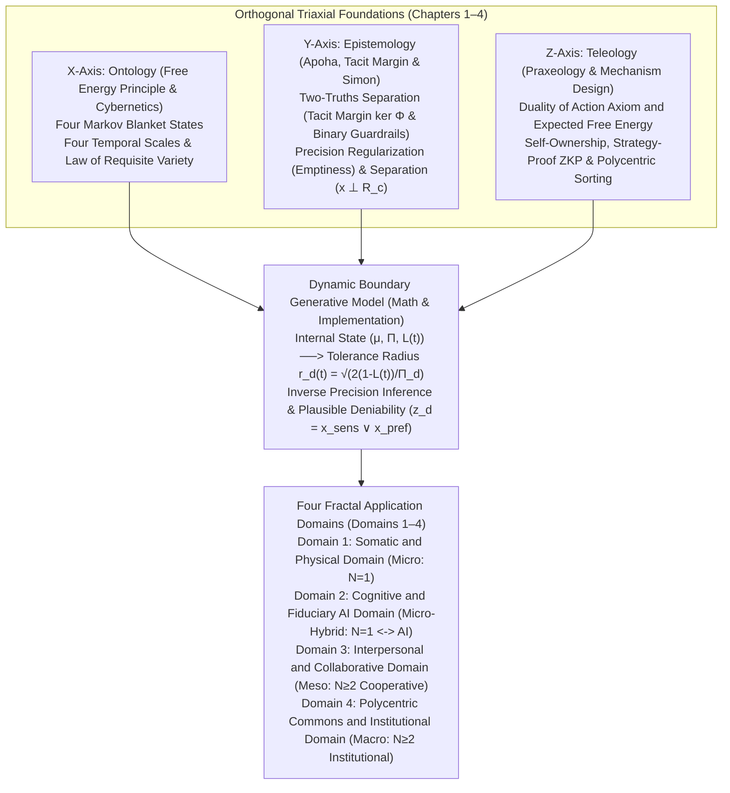

# Praxeophysics

**Praxeophysics** is a theoretical and protocol design framework formulated and maintained by the **Praxeophysics Institute**. It integrates the boundary-maintenance mechanics of self-organizing systems, bounded-rational epistemology, and institutional mechanism design on a unified mathematical architecture, establishing a third coordination infrastructure—**[[Term_Synallactics|Synallactics]]** (non-price boundary reconciliation)—alongside bureaucratic standardization and monetary market exchange ([[Term_Catallactics|Catallactics]]).

---

## 1. Unifying Principle: Interior Opacity and Three Orthogonal Axes
Rather than modeling agents as positive interior utility points, Praxeophysics enforces **Interior Opacity and Apoha Boundary Sufficiency ([[Claim_Interior_Opacity_Principle|Principle of Interior Opacity and Apoha Boundary Sufficiency]])**: interior generative states $(\boldsymbol{\mu}, \boldsymbol{\Pi}, L(t))$ and tacit know-how $\ker\Phi$ remain opaque inside the [[Term_Storage_Holder|Personal Data Store]], while only negative [[Term_Boundary_Envelope|Boundary Envelopes]] $[a_{i,d}(t), b_{i,d}(t)]$ are exported for coordination. 
Praxeophysics avoids single-discipline reductionism by intersecting three orthogonal axes, where each axis resolves the structural blind spots of the other two:

1. **X-Axis [Ontology: Free Energy Principle & Cybernetics] ([[Claim_Statistical_Boundary|Statistical Boundary and Individuated Existence]]–[[Claim_Internal_Prior_Sovereignty|Exclusive Sovereignty of Internal Priors and Law of Requisite Variety]])**:
   Provides the foundational **physical and information-geometric mechanics** of how systems with a statistical boundary ([[Term_Markov_Blanket|Markov Blanket]]) maintain a [[Term_NESS|Nonequilibrium Steady State]] by minimizing [[Term_VFE|Variational Free Energy]] and [[Term_EFE|Expected Free Energy]]. However, physics alone does not specify how to prevent symbolic overfitting in discrete representations, nor how to design strategy-proof property and institutional rules among competing agents
2. **Y-Axis [Epistemology: [[Term_Apoha|Apoha]] Logic, [[Term_Tacit_Knowledge|Tacit Knowledge]] & Bounded Rationality] ([[Claim_Orthogonal_Atomic_Decomposition|Orthogonal Decomposition into Atomic Predicates in Finite Systems]]–[[Claim_Attribute_Rule_Separation|Structural Separation of Personal Attributes and Contextual Rules]])**:
   Provides the **epistemological meta-control** that prevents symbolic pathology (behavioral over-specification, 1D scalar reduction, and conceptual reification). It formalizes **[[Term_Two_Truths|Two-Truths Separation]]** between continuous embodied reality ([[Term_Tacit_Knowledge|Tacit Knowledge]] margin $\ker \Phi$) and minimal negative binary guardrails ([[Term_Apoha|Apoha]] predicates $x_d \in \{0, 1\}$), **[[Term_Sunyata|Emptiness]]** (higher-order precision regularization) against prior [[Term_Overfitting|Overfitting]], and **[[Term_Attribute_Rule_Separation|Attribute-Rule Separation]]** ($\mathbf{x} \perp R_c$) grounded in [[Person_Herbert_Simon|Simon]]'s [[Term_Bounded_Rationality|Bounded Rationality and Structure Learning]]
3. **Z-Axis [Teleology: Praxeology, Mechanism Design & Polycentricity] ([[Claim_Action_As_Friction_Minimization|Purposeful Action as Variational Friction Minimization]]–[[Claim_Dispersed_Knowledge_Polycentricity|Locality of Dispersed Knowledge and Superiority of Polycentric Governance]])**:
   Provides the **multi-agent institutional and incentive architecture** under scarcity. It formalizes the duality between the [[Term_Action_Axiom|Action Axiom]] and [[Term_EFE|Expected Free Energy]], [[Term_Demonstrated_Preference|Demonstrated Preference]], [[Term_Coasean_Bargaining|Coasean Bargaining and Transaction Costs]] grounding [[Term_Self_Ownership|Self-Ownership]] and fiduciary AI binding, **[[Term_Strategy_Proofness|Strategy-Proofness]]** under the Myerson-Satterthwaite theorem, and **[[Term_Frictionless_Exit|No-Fault Sorting]]** enabling [[Person_Elinor_Ostrom|Ostrom]]'s **[[Term_Polycentric_Order|Polycentric Order]]**

---

## 2. Unified Architecture Across Six Dimensions
Praxeophysics and the **Praxeophysics Protocol** are structured across six dimensions: **(1) Boundary Structure**, **(2) Temporal Dynamics**, **(3) Mathematical Objectives**, **(4) Computational Implementation**, **(5) Fundamental Trade-offs**, and **(6) Fractal Scale Hierarchy**.

### ① [Structure] Four States & Roles of the Markov Blanket and Four Functional Pipelines
| Role / Blanket State | Position, Vector & Target | Processing Role & Analog | Corresponding Protocol Pipeline & Implementation |
| :--- | :--- | :--- | :--- |
| **1. Observation / [[Term_Sensory_States\|Sensory States]]** | Input (Out $\to$ In) Target: [[Term_Internal_States\|Internal States]] | Signal reception & observation encoding Analog: Sensory organs, sensors, API inputs | **1. [[Term_Ingestion\|Ingestion Pipeline]]**: Boundary inputs $s(t)$, [[Term_Apoha\|Apoha]] demarcation, and [[Term_Inverse_Precision_Inference\|Inverse Precision Inference]] of $r_d(t)$ |
| **2. Inference / [[Term_Internal_States\|Internal States]]** | Interior (In $\to$ In) Target: [[Term_Active_States\|Active States]] | Generative model retention & predictive calculation Analog: Neural circuits, beliefs, database | **2. [[Term_Storage_Holder\|Personal Data Store]]**: Exclusive retention of $(\boldsymbol{\mu}, \boldsymbol{\Pi}, L(t))$ & $\ker \Phi$, [[Term_Attribute_Rule_Separation\|Attribute-Rule Separation]] ($\mathbf{x} \perp R_c$), [[Term_Epoch_Reconfiguration\|Epoch Re-configuration]] |
| **3. Action / [[Term_Active_States\|Active States]]** | Output (In $\to$ Out) Target: [[Term_External_States\|External States]] | Inference-driven physical & informational intervention Analog: Muscles, limbs, actuators | **3. [[Term_Verification\|Verification Pipeline]]**: [[Term_Selective_Disclosure\|Selective Disclosure]] / [[Term_ZKP\|ZKP]] over $x_d(t) \in \{0, 1\}$, [[Term_Plausible_Deniability\|Plausible Deniability]], [[Term_Personal_Agent_A2A\|Personal Fiduciary Agent]] |
| **4. Dynamics / [[Term_External_States\|External States]]** | Exterior (Out $\to$ Out) Target: [[Term_Sensory_States\|Sensory States]] | Autonomously evolving environmental dynamics Analog: Physical laws, other agents, markets, nature | **4. [[Term_Reconciliation_Adapter\|Reconciliation Adapter]]**: Contextual rule evaluation $R_c$, [[Term_Alignment\|Environmental Alignment]], 4 Reconciliation Directives, [[Term_Strategy_Proofness\|Strategy-Proofness]] ZKP |

### ② [Dynamics] Four Temporal Scales of Free Energy Minimization and Adaptive Processes
| Temporal Scale & Process | Error-Reduction Mode | Corresponding Praxeophysics Protocol Adaptive Process & Directive |
| :--- | :--- | :--- |
| **1. [[Term_Perceptual_Inference\|Perceptual Inference]]** (ms–s) | Receptive updating of internal interpretation | Receptive updating in low-precision ($\Pi_d$ low, wide radius $r_d(t)$) dimensions (`perceptual_update`) and the delegating party in **`COMPLEMENTARY_DELEGATION`** ([[Term_Reconciliation\|Complementary Reconciliation]]) |
| **2. [[Term_Active_Inference\|Active Inference]]** (s–min) | Active intervention to defend internal priors | Defending narrow tolerance radii ($\lvert s_d - \mu_d \rvert \le r_d(t)$) via **[[Term_Alignment\|Environmental Alignment]]** (`active_alignment`), **`ALLOSTATIC_LOAD_RELIEF`**, and **`FRICTIONLESS_EXIT_SORTING`** ([[Term_Frictionless_Exit\|No-Fault Sorting]]) |
| **3. [[Term_Dynamic_Boundary_Learning\|Learning]]** (days–yrs) | Updating generative model parameters | Bayesian updating of $(\boldsymbol{\mu}, \boldsymbol{\Pi}, r_d)$ from empirical load logs $L(t)$ via **[[Term_Dynamic_Boundary_Learning\|Dynamic Boundary Learning]]** and **[[Term_Epoch_Reconfiguration\|Epoch Re-configuration]]** |
| **4. [[Term_Niche_Construction\|Niche Construction]]** (yrs–eras) | Structuring external schemas and institutions | Designing low-friction interfaces via **`INTERFACE_DECOUPLING`**, reference-based **[[Term_Strategy_Proofness\|Strategy-Proofness]]** ZKP settlement ($p_{\text{ref}}$), and **[[Term_Synallactics\|Synallactics]]** |

### ③ [Mathematics] Three Objective Functions and the Dynamic Boundary Generative Model
Under the [[Term_Laplace_Approximation|Laplace approximation]], an agent's continuous internal state across $D$ orthogonal dimensions is parameterized by: (1) **[[Term_Prior_Distribution|Preference Prior]] ([[Term_Prior_Distribution|Prior Mean Vector]])** $\boldsymbol{\mu} \in \mathbb{R}^D$, (2) **[[Term_Precision_Weighting|Precision Weighting]] Vector** $\boldsymbol{\Pi} \in \mathbb{R}_+^D$ ($\Pi_d = \sigma_d^{-2}$) subject to finite attentional conservation $\sum_{d=1}^D \Pi_d = \Pi_{\text{budget}}$, and (3) **[[Term_Allostatic_Load|Allostatic Load]]** $L(t) \in [0, 1)$ reducing remaining **[[Term_Homeostatic_Capacity|Homeostatic Capacity]]** $C(t) = 1 - L(t)$.

Bounding instantaneous [[Term_VFE|Variational Free Energy]] within remaining [[Term_Homeostatic_Capacity|Homeostatic Capacity]] $1 - L(t)$ yields the binary [[Term_Atomic_Predicate|Atomic Predicate]] $x_d(t) \in \{0, 1\}$ and the **[[Term_Allowable_Tolerance_Radius|Allowable Tolerance Radius]]** $r_d(t)$:
$$x_d(t) = \mathbb{I}\left(\frac{1}{2}\Pi_d(s_d - \mu_d)^2 \le 1 - L(t)\right) \iff \lvert s_d - \mu_d \rvert \le r_d(t) = \sqrt{\frac{2(1 - L(t))}{\Pi_d}}$$

* **Within-Dimension Precision–Tolerance Reciprocity ([[Term_Inverse_Precision_Inference|Inverse Precision Inference]])**: Because precision $\Pi_d$ is inverse variance ($\sigma_d^{-2}$), high positive commitment to dimension $d$ directly narrows the allowable tolerance radius $r_d(t)$ on that exact same dimension $d$, deriving protective guardrails without negative self-reporting questionnaires
* **Cross-Dimension Attentional Conservation (Basis of Complementarity)**: Because $\sum_{d=1}^D \Pi_d = \Pi_{\text{budget}}$, high precision allocated to dimension $d$ lowers precision $\Pi_k$ on other dimensions $k (\neq d)$, widening their tolerance radii $r_k(t)$ and enabling friction-free delegation (`COMPLEMENTARY_DELEGATION`)

When two agents $A$ and $B$ couple, minimizing joint variational free energy $F_{\text{joint}}(u_d) = \frac{1}{2}\Pi_{A,d}(u_d - \mu_{A,d})^2 + \frac{1}{2}\Pi_{B,d}(u_d - \mu_{B,d})^2$ over the intersection of their radii resolves pairs sharing the **exact same baseline divergence ($\Delta\mu = \lvert \mu_A - \mu_B \rvert = 0.40$, which conventional 1D models collapse into a `0.60` scalar score and `0.50` midpoint)** into four distinct directives:

| Regime & Mathematical Condition | Derived Radii ($r_A, r_B$) & Optimal State $u^*_d$ | Conventional 1D Algorithm Output | Praxeophysics Directive & Prescription |
| :--- | :--- | :--- | :--- |
| **1. Precision Asymmetry** $\Pi_A = 9.0, \Pi_B = 1.0, L = 0.15$ (SAT: $\Delta\mu \le r_A + r_B$) | $r_A = 0.43, r_B = 1.30$ $u^*_d = \frac{\Pi_A\mu_A + \Pi_B\mu_B}{\Pi_A + \Pi_B} \approx \mu_A$ Residual Friction $F^*_{\text{joint}} = 0.072 \ll F_{\text{mid}} (0.200)$ | Scalar Score `0.60` (Uniform midpoint `0.50`) | **`COMPLEMENTARY_DELEGATION`** ([[Term_Complementary_Delegation\|Complementary Delegation]]) A midpoint average leaves high prediction error on $A$; aligning with $A$'s narrow radius ($u^*_d \approx \mu_A$) while $B$ delegates minimizes joint friction |
| **2. Symmetric Autonomy** $\Pi_A = 2.0, \Pi_B = 2.0, L = 0.10$ (SAT: $\Delta\mu \le r_A + r_B$) | $r_A = 0.95, r_B = 0.95$ High harmonic precision $\frac{\Pi_A\Pi_B}{\Pi_A+\Pi_B}$ if forced into one process | Scalar Score `0.60` (Uniform midpoint `0.50`) | **`INTERFACE_DECOUPLING`** ([[Term_Interface_Decoupling\|Interface Decoupling]]) Keep internal processes independent ($\mu_A, \mu_B$) and synchronize strictly via a shared interface schema or checkpoint |
| **3. Disjoint Guardrails** $\Pi_A = 50.0, \Pi_B = 50.0, L = 0.20$ (**UNSAT**: $\Delta\mu > r_A + r_B$) | $r_A = 0.18, r_B = 0.18$ $\mathcal{U}_A \cap \mathcal{U}_B = \emptyset$ ($0.40 > 0.36$: Disjoint) | Scalar Score `0.60` (Uniform midpoint `0.50`) | **`FRICTIONLESS_EXIT_SORTING`** ([[Term_Frictionless_Exit\|No-Fault Sorting]]) A midpoint average ($0.50$) violates both protective boundaries; separate into parallel niches without penalty |
| **4. Acute Load Contraction** $\Pi_A = 2.0, \Pi_B = 2.0, L_A(t) = 0.85$ (Overload: $L_A \ge 0.75$) | Capacity $1 - L_A = 0.15$ $r_A(t)$ contracts from $0.95 \to 0.39$ | Scalar Score `0.60` (Static parameter weight) | **`ALLOSTATIC_LOAD_RELIEF`** ([[Term_Allostatic_Load_Relief\|Allostatic Load Relief]]) Triggered by acute depletion of homeostatic capacity $1 - L_A(t)$ rather than prior divergence; suspend demands and restore capacity |

### ④ [Implementation] Five Predictive Coding Mechanisms and Five Core Design Axioms
1. **Top-Down Prediction ⟷ Axiom 1: Individual-Origin Control** (Exclusive sovereignty of internal priors $\boldsymbol{\mu}$: [[Claim_Internal_Prior_Sovereignty|Exclusive Sovereignty of Internal Priors and Law of Requisite Variety]], [[Claim_Subjective_Ordinal_Value|Subjective Value as Internal Preference Ordering]])
2. **[[Term_Sensory_Precision|Sensory Precision]] ⟷ Axiom 2: Orthogonal [[Term_Atomic_Predicate|Atomic Predicates]]** (High-resolution binary guardrails and plausible deniability: [[Claim_Binary_Guardrail_Predicate|Binary Guardrail Predicate Function Based on Causal Efficacy]], [[Claim_Rejection_Of_Scalar_Reduction|Rejection of Single-Scalar Reduction and Preservation of Orthogonality]])
3. **Hierarchical [[Term_Generative_Model|Generative Model]] ⟷ Axiom 3: Two-Truths and [[Term_Attribute_Rule_Separation|Attribute-Rule Separation]]** ($\mathbf{x} \perp R_c$: [[Claim_Two_Truths_Tacit_Separation|Two-Truths Separation of Continuous Tacit Reality and Discrete Guardrails]], [[Claim_Attribute_Rule_Separation|Structural Separation of Personal Attributes and Contextual Rules]])
4. **Bottom-Up [[Term_Prediction_Error|Prediction Error]] ⟷ Axiom 4: Minimization of Variational Friction and Allostatic Load** ([[Claim_Variational_Free_Energy_Minimization|Generative Updating and Action via Variational Free Energy Minimization]], [[Claim_Action_As_Friction_Minimization|Purposeful Action as Variational Friction Minimization]])
5. **[[Term_Prior_Precision|Prior Precision]] ⟷ Axiom 5: Higher-Order Regularization ([[Term_Sunyata|Emptiness]]) and Infrastructure Neutrality** ([[Claim_Emptiness_Precision_Regularization|De-reification via Emptiness and Higher-Order Precision Regularization]], [[Claim_Bounded_Rationality_Open_Schema|Bounded Rationality and the Necessity of Open Schema Extension]])

### ⑤ [Constraints] Six Fundamental Trade-offs and Twelve Pathologies Resolved (See [[03_Breakthroughs|Six Fundamental Trade-offs and Twelve Pathologies]])
| # | Mathematical Source & Trade-off | Polar Pathologies (Pole A vs. Pole B) | Praxeophysics Resolution & Engine Method |
| :--- | :--- | :--- | :--- |
| **1** | **Markov Blanket Partition** Statistical Insulation vs. Coupling | Pole 1A Atomistic isolation vs. Pole 1B Boundary dissolution & AI-principal conflation | **Principle of Interior Opacity ([[Claim_Interior_Opacity_Principle\|Principle of Interior Opacity and Apoha Boundary Sufficiency]]) & [[Term_Boundary_Envelope\|Boundary Envelopes]]** (`exportBoundaryEnvelope`) + [[Term_Extended_Markov_Blanket\|Extended Markov Blanket]] AI binding ([[Claim_Extended_Blanket_Fiduciary_Agency\|Property Boundaries and Fiduciary AI as Extended Markov Blankets]]) |
| **2** | **Variational Free Energy ($F$)** Model Complexity vs. Accuracy | Pole 2A Behavioral over-specification vs. Pole 2B 1D scalar collapse | **[[Term_Two_Truths\|Two-Truths Separation]] ([[Claim_Two_Truths_Tacit_Separation\|Two-Truths Separation of Continuous Tacit Reality and Discrete Guardrails]])** preserving tacit margin $\ker\Phi$ inside orthogonal [[Term_Atomic_Predicate\|Atomic Predicates]] (`assertValidState`, [[Claim_Rejection_Of_Scalar_Reduction\|Rejection of Single-Scalar Reduction and Preservation of Orthogonality]]) |
| **3** | **Hierarchical Precision ($\Pi$)** Sensory Plasticity vs. Prior Rigidity | Pole 3A Unbuffered sensory overload vs. Pole 3B Dogmatic reification & platform lock-in | **[[Term_Inverse_Precision_Inference\|Inverse Precision Inference]]**, `ALLOSTATIC_LOAD_RELIEF`, [[Term_Sunyata\|Emptiness]] regularization & **[[Term_Attribute_Rule_Separation\|Attribute-Rule Separation]] ($\mathbf{x} \perp R_c$)** (`stepEpochLearning`, [[Claim_Attribute_Rule_Separation\|Structural Separation of Personal Attributes and Contextual Rules]]) |
| **4** | **Expected Free Energy ($G(\pi)$)** Homeostatic Safety vs. Exploration | Pole 4A Reckless boundary breakdown vs. Pole 4B Dark-Room stagnation ($\sigma_\pi^2 \to 0$) | **Boundary-Envelope Inclusion EFE (`evaluateExpectedFreeEnergy`)**: unpenalized interior variance unlocks [[Term_Epistemic_Value\|Epistemic Value]] as $1-L(t)$ expands ([[Claim_Homeostatic_Capacity_Unlocks_Exploration\|Unlocking Epistemic Exploration via Homeostatic Capacity Expansion]]) |
| **5** | **Multi-Blanket VFE Coupling** Active Imposition vs. Passive Yielding | Pole 5A Uniform 50:50 midpoint compromise vs. Pole 5B Symmetrical [[Term_Schismogenesis\|Schismogenesis]] | **Silver-Ratio Branching ($\max(r_B/r_A, r_A/r_B) > 1+\sqrt{2}$: `reconcileEnvelopes`)** between `COMPLEMENTARY_DELEGATION` & `INTERFACE_DECOUPLING`, plus Helly SAT Clique Sorting (`sortCompatibleCohorts`, [[Claim_Joint_VFE_Silver_Ratio_Branching\|Orthogonal Joint VFE Decomposition and Delegation vs. Decoupling Branching]]) |
| **6** | **Asymmetric Information Games** Signaling Transparency vs. Opacity | Pole 6A Vulnerability stigma & reverse-inference vs. Pole 6B Myerson–Satterthwaite bluffing | **OR/RR [[Term_Plausible_Deniability\|Plausible Deniability]] (`evaluateAlignment`)**, budget normalization ($\sum\Pi_d \le \Pi_{\text{budget}}$) & **[[Term_Posted_Reference_Mechanism\|Posted-Reference DSIC ZKP Settlement]] (`evaluateStrategyProofSettlement`, [[Claim_Posted_Reference_DSIC_Mechanism\|Posted-Reference DSIC Mechanism and the Efficiency-Incentive Trade-off]])** |

### ⑥ [Hierarchy] Four Fractal Application Domains: 2×2 Coupling Topology Matrix (See [[01_Specification|Praxeophysics Protocol Specification]])
| Application Domain | Coupling Topology & Blanket Realization | Representative Scope (Non-Exhaustive Examples) | Active Adaptive Processes & Directives |
| :--- | :--- | :--- | :--- |
| **Domain 1: Somatic and Physical Domain** | Micro ($N = 1 \leftrightarrow \text{Physical Environment}$) Sensory receptors, autonomic homeostasis | Apparel/fashion fit & tactile materials, cosmetics/skincare ingredients, dining & nutrition, smart home/hotel/salon/mobility comfort & interaction pacing (e.g., quiet-ride/service boundaries) | [[Term_Alignment\|Environmental Alignment]], [[Term_Plausible_Deniability\|Plausible Deniability]], `ALLOSTATIC_LOAD_RELIEF`, `FRICTIONLESS_EXIT_SORTING` |
| **Domain 2: Cognitive and Fiduciary AI Domain** | Micro-Hybrid ($N = 1 \leftrightarrow \text{Fiduciary AI}$) Cognitive state $(\boldsymbol{\mu}, \boldsymbol{\Pi}, L(t))$, tacit margin $\ker \Phi$, Extended Blanket AI | Intention-driven commerce (cross-brand AI product filtering without ad-network tracking), adaptive UI density, AI interruption throttling, preserving creative flow $\ker\Phi$ | `ALLOSTATIC_LOAD_RELIEF`, `COMPLEMENTARY_DELEGATION`, `INTERFACE_DECOUPLING`, [[Term_Dynamic_Boundary_Learning\|Dynamic Boundary Learning]] |
| **Domain 3: Interpersonal and Collaborative Domain** | Meso-Cooperative ($N \ge 2 \text{ Coupled Agents}$) Intersecting tolerance sets $\mathcal{U}_A \cap \mathcal{U}_B$, shared schemas | **(a) Dating, Marriage & Co-Living** (reciprocal $\boldsymbol{\Pi}$ duality, ZKP dealbreaker filtering on money/hygiene/solitude/relatives & household division), **(b) Group Dining, Travel & Social Gatherings** (awkwardness-free budget/curfew/diet intersection), **(c) Care, Education & Co-Creation** | `COMPLEMENTARY_DELEGATION`, `INTERFACE_DECOUPLING`, `ALLOSTATIC_LOAD_RELIEF`, `FRICTIONLESS_EXIT_SORTING` |
| **Domain 4: Polycentric Commons and Institutional Domain** | Macro-Institutional ($N \ge 2 \text{ Scarce Commons}$) Polycentric rule circuits $R_c$, ZKP verifiers, benchmark $p_{\text{ref}}$ | Shared/public commons zoning, P2P freelance escrow, bilateral contracting, Alternative Dispute Resolution (ADR), polycentric governance, etc. | [[Term_Strategy_Proofness\|Strategy-Proofness]] ZKP Settlement, `FRICTIONLESS_EXIT_SORTING`, `INTERFACE_DECOUPLING`, [[Term_Attribute_Rule_Separation\|Attribute-Rule Separation]] |

---

## 2-7. Reproducible Empirical Benchmarks (Suite v4) and Threat Model Scope
Across deterministic Node.js/TypeScript simulations (Suite v4: `N = 1,000` dyads, multi-scale pools $M \in \{20, 100\}$ over `30` epochs with `4%` exogenous stress shocks and $\kappa = 0.20$ interface-translation drag, plus four cross-domain use-case benchmarks; see [[01_Specification|Praxeophysics Protocol Specification]] Sections `3-4` and `5-3` for full tables and threat-model boundaries):
* **Exp 1 — Dyadic Budget Sweep via Boundary Envelopes ($\Pi_{\text{budget}} = 100$)**: Reduces guardrail violations from `2.83%` (`SCALAR_MIDPOINT`) to **`0.01%`** (283x reduction), lowers mean VFE from `0.6414` to **`0.0863`** (7.4x reduction), and eliminates chronic post-overload (`0.28%` $\to$ **`0.00%`**).
* **Exp 2 — Multi-Scale Pool Cohort Sorting ($M=20, 100$)**: Achieves **`0.00%`** violations (`0.0189` VFE at $M=20$; `0.0107` VFE at $M=100$) at $k=2$, outperforming both unweighted nearest-neighbor (`0.14%` violations, `0.0621` VFE) and precision-weighted point consensus (`0.0578` VFE at $M=20$; `0.0463` VFE at $M=100$), while scaling to 4-agent cliques (`K4`: **`0.00%`** violations, `0.0192` VFE).
* **Exp 3 & 4 — Epistemic Exploration ($G(\pi)$) & Learning Stability**: Expands frontier epistemic exploration from `71.21%` to **`76.26%`** (`0.4963` vs. `0.4250` nats/decision) while cutting Dark-Room retreat from `12.44%` to **`0.22%`**.
* **Exp 5 (5A–5D) — Cross-Domain Killer Use-Case Benchmarks**:
  * **5A. Hospitality, Salon, Mobility & Retail (`N = 1,000`)**: Eliminates polite-silence (*tatemae*) churn (`74.10%` $\to$ **`0.00%`**) and lowers VFE (`2.9526` $\to$ **`0.0102`**) while bounding Bayesian posterior attribution risk at **`30.61%`** (vs. `100.00%` under verbal confession).
  * **5B. 4-Person Group Dining & Travel (`N = 500` groups)**: Breaks the group-chat *tatemae* deadlock (`0.00%` $\to$ **`100.00%`** group satisfaction, `3.9720` $\to$ **`0.8179`** VFE) at **`30.61%`** attribution risk.
  * **5C. Dating, Marriage & Co-Living Topology (`25` pools $\times 40$ agents)**: Cuts co-living guardrail breakups from `26.80%` (1D hobby matching) and `9.00%` (6D midpoint homogeneity) to **`0.00%`** (`0.0491` VFE) via `20.00%` Reciprocal Duality (`COMPLEMENTARY_DELEGATION`) and `80.00%` Modular Parallelism (`INTERFACE_DECOUPLING`).
  * **5D. Bilateral Freelance / ADR Settlement (`N = 1,000` deals, $p_{\text{ref}} \sim \mathcal{U}(0.35, 0.65)$)**: Eliminates strategic bluffing incentives (`100.00%` $\to$ **`0.00%`**) and private reservation exposure (`100.00%` $\to$ **`0.00%`**) while raising settlement rate from `67.60%` to **`75.00%`**.

---

## 3. Frequently Asked Questions

> [!question]- Q1: Does this model merely add two extra weights (Precision $\Pi$ and Load $L$) to a conventional matching algorithm?
> **No.** Conventional recommendation, matching, and allocation algorithms represent agents as **static points** and output a continuous 1D scalar similarity score (e.g., `0.60`) or converge on a uniform midpoint average ($u = (\mu_A + \mu_B)/2 = 0.50$).
>
> The [[Term_Dynamic_Boundary_Model|Dynamic Boundary Generative Model]] replaces **point-to-point distance** with **topological set satisfiability (SAT / UNSAT)** by projecting $(\mu_d, \Pi_d, L(t))$ into an allowable tolerance radius $r_d(t) = \sqrt{2(1 - L(t)) / \Pi_d}$ and exporting only the negative [[Term_Boundary_Envelope|Boundary Envelope]] $[a_d(t), b_d(t)]$, enabling four operations impossible in scalar distance models:
> 1. **Detecting boundary disjointness (UNSAT)** when a midpoint average violates both parties' guardrails, triggering [[Term_Frictionless_Exit|No-Fault Sorting]] (`FRICTIONLESS_EXIT_SORTING`)
> 2. **Computing boundary stiffness delegation ($u^*_d = \frac{\widetilde{\Pi}_A c_A + \widetilde{\Pi}_B c_B}{\widetilde{\Pi}_A + \widetilde{\Pi}_B}$)**, showing that when the Silver Ratio $\max(r_B/r_A, r_A/r_B) > 1+\sqrt{2}$ holds, aligning with the narrower envelope minimizes joint variational free energy (`COMPLEMENTARY_DELEGATION`)
> 3. **Deriving protective boundaries without negative self-reporting** via within-dimension precision–tolerance reciprocity ([[Term_Inverse_Precision_Inference|Inverse Precision Inference]])
> 4. **Separating baseline prior divergence ($\Delta\mu$) from acute load contraction ($L(t)$)** (`ALLOSTATIC_LOAD_RELIEF`)

> [!question]- Q2: Why doesn't the user have to explicitly input their weaknesses, dealbreakers, or vulnerabilities?
> Under a Gaussian generative density, precision $\Pi_d$ is inverse variance ($\Pi_d = \sigma_d^{-2}$). Therefore, investing high positive commitment (high $\Pi_d$) in dimension $d$ directly narrows the allowable tolerance radius $r_d(t) = \sqrt{2(1 - L(t)) / \Pi_d}$ on that exact same dimension $d$.
>
> Simultaneously, by attentional conservation ($\sum_{d=1}^D \Pi_d = \Pi_{\text{budget}}$: [[Claim_Attentional_Precision_Conservation|Conservation of Finite Attentional Precision and Delegation Margins]]), other dimensions $k (\neq d)$ receive lower precision $\Pi_k$, widening their tolerance radii $r_k(t)$ for delegation. **[[Term_Inverse_Precision_Inference|Inverse Precision Inference]]** thus derives both protective guardrails and delegable margins directly from positive inputs, eliminating self-reporting stigma and social desirability bias.

> [!question]- Q3: What prevents a strategic agent from claiming maximum precision ($\Pi_d \to \infty$) on every dimension to force others to yield?
> Two mathematical mechanisms make strategic inflation of $\Pi_d$ self-defeating ([[Claim_Precision_Inflation_Deterrence|Incentive Compatibility of Precision Claims: Budget Normalization and the UNSAT Exclusion Penalty]], [[Term_Incentive_Compatibility|Incentive Compatibility]]):
> 1. **Attentional Budget Conservation ($\sum_{d=1}^D \Pi_d = \Pi_{\text{budget}}$)**: Precision is normalized across all $D$ dimensions; claiming high $\Pi$ everywhere dilutes $\Pi_d$ across all dimensions to the uniform mean.
> 2. **The UNSAT Exclusion Penalty**: Artificially inflating $\Pi_d$ shrinks one's own tolerance radius $r_d(t) = \sqrt{2(1 - L(t)) / \Pi_d} \to 0$. A near-zero radius causes the intersection check $\max(a_A, a_B) \le \min(b_A, b_B)$ to fail (**UNSAT**), resulting in automatic non-penalized exclusion (`FRICTIONLESS_EXIT_SORTING`) rather than coercive domination.

> [!question]- Q4: Even if inputs are hidden via Zero-Knowledge Proofs, can observers reverse-engineer sensitive conditions from the final output?
> To prevent [[Term_Bayesian_Reverse_Inference|output inference attacks]], [[Claim_Verification_ZKP_And_Deniability|Verification Specification: Selective Disclosure, ZKP, and Plausible Deniability]] enforces [[Person_Cynthia_Dwork|Dwork]]-inspired **[[Term_Plausible_Deniability|Plausible Deniability]]** ($z_d = x_{\text{sens},d} \lor x_{\text{pref},d}$).
>
> Whether a boundary stems from a tight budget, introverted social-battery depletion, personal lifestyle values, or a physiological sensitivity, it is pooled into the exact same output request class as a casual everyday preference. Outside observers cannot distinguish whether a request is an essential guardrail or a temporary mood, bounding Bayesian posterior attribution risk to $\Pr(x_{\text{sens}} = 1 \mid z = 1) \le 30.61\%$ (under baseline priors $p_{\text{sens}}=0.15, p_{\text{pref}}=0.40$).

> [!question]- Q5: Does automated environmental and interpersonal tuning erode human tacit knowledge and autonomy?
> By [[Claim_Two_Truths_Tacit_Separation|Two-Truths Separation of Continuous Tacit Reality and Discrete Guardrails]] ([[Term_Two_Truths|Two-Truths Separation]]) and [[Person_Michael_Polanyi|Polanyi]]'s [[Term_Tacit_Knowledge|Tacit Knowledge]], discrete [[Term_Atomic_Predicate|Atomic Predicates]] act **strictly as minimal negative guardrails** that exclude boundary breakdown ($x_d = 0$).
>
> Inside the viable zone ($\lvert s_d - \mu_d \rvert \le r_d(t)$), the protocol refrains from intervention, preserving embodied tacit dynamics ($\ker \Phi$). Furthermore, by [[Claim_Pragmatic_Epistemic_Decomposition|Decomposition into Pragmatic Value and Epistemic Value]] and [[Claim_Homeostatic_Capacity_Unlocks_Exploration|Unlocking Epistemic Exploration via Homeostatic Capacity Expansion]], reducing baseline friction $L(t)$ expands homeostatic capacity $1 - L(t)$, unlocking **[[Term_Epistemic_Value|Epistemic Value]]** and creative exploration rather than behavioral homogenization.

> [!question]- Q6: How does this protocol replace monopolistic SaaS platforms?
> Conventional Web2 platforms operate as [[Term_Stationary_Bandit|Stationary Bandits]] ([[Claim_Stationary_Bandit_Equilibrium|Game-Theoretic Nash Equilibrium of the Stationary Bandit]]): they trap user attribute data ($\mathbf{x}$) inside proprietary silos fused with platform-specific rules ($R_c$).
>
> By enforcing **[[Term_Attribute_Rule_Separation|Attribute-Rule Structural Separation]]** ($\mathbf{x} \perp R_c$: [[Claim_Attribute_Rule_Separation|Structural Separation of Personal Attributes and Contextual Rules]]) and delegating negotiation to the user's local **[[Term_Personal_Agent_A2A|Personal Fiduciary Agent]]**, a single self-sovereign state $(\boldsymbol{\mu}, \boldsymbol{\Pi}, L(t))$ coordinates peer-to-peer across all four domains (apparel/cosmetics, group travel/dining, marriage/co-living, ADR contracting) without middleman data capture.

---

## 4. Core Monographs, Specifications and Glossaries

* **Canonical Knowledge Index (Canonical Claims, Defined Terms, Foundational Thinkers, and Primary Literature)**:
  * [[00_Canonical_Index|00. Praxeophysics Canonical Knowledge Index]]
* **English Canonical Editions**:
  * [[01_Specification|01. Praxeophysics Protocol Specification v4.2.0]]
  * [[02_Glossary|02. Praxeophysics Canonical Glossary v4.2.0]]
  * [[03_Breakthroughs|03. Six Fundamental Trade-offs and Twelve Pathologies Resolved by Praxeophysics]]

* **Bibliography, Governance and Contact**:
  * [[References|References]] ／ [[Governance_and_IP_Policy|Governance, Open Standard License & Prior IP Policy]]
  * **[Official Inquiry Form — Praxeophysics Institute](https://forms.gle/GxFCbK4oic87dJVA8)**
